# Model

Het staat model voor digitale tuintjes welke bij 'Het web is voor iedereen' door studenten worden gemaakt.

## Learning Log

Leg uit wat een source hosting platform is en voor welke jij gekozen hebt.
Een source hosting is een platform waaronder codeurs/ programmeurs hun code naar uploaden zodat ze in een omgeving remote met elkaar kunnen samenwerken. Op dit platform kan ej code uploaden, downloaden en elkaar pullrequest aanmaken en goed keuren. Zo kunnen ze van elke plek aan hetzelfde project werken maar ook tegelijkertijd.

Vertel welke domeinnaam jij gekozen hebt en hoe je die hebt gekoppeld aan jouw pagina.
Ik heb bloomingskilss gekozen omdat ik op deze oefenwebsite en eindopdracht mijn skilss gaat ontwikkelen. Daarbij vond ik de naam heel erg toepasselijk.

Beschrijf hoe je aanpassingen aan jouw pagina kunt maken en hoe je er voor zorgt dat die op het web gepubliceerd worden.
Als je een stukje code heb geschreven upload je die naar Github. In github zit er een ingebouwde hosting die ik aan mijn domein heb gekoppeld. Door mijn code te uploaden naar github de main branch. upload je gelijktijdig je code naar je website toe dat live staat.

### Donderdag 22 Oktober
Op donderdag ben ik vooral bezig geweest met het maken van 1 karakterdetailpage. Ik heb dit gedaan zodat de gebruiker een beeld heeft van hoe een detail page eruit ziet.
Ik heb een pagina gemaakt voor de eerste character die je ziet op de karakter overview pagina en de homepagina. Ik heb het zo kort gehouden zodat de gebruiker de informatie overzichtelijk kan zien. ik heb deze pagina eerst voor mobiel gemaakt en heb hierbij de style van de homepage behouden.

Naast het maken van deze pagina ben ik gaan kijken of mijn project voldoet aan de eisen en randvoorwaarden. 
Ik heb de kleien puntjes op de i gezet, gechecked of alle linkjes werken en ook gechecked of de website fluide is.
.png).
.png).

### Woensdag 21 oktober
Op woensdag heb ik de volgende dingen gedaan:
- bi-weekly
- Build a lightsaber page veranderd
- bijwerken van em learning log

In de les hebbenw e eerst een paar stellingen gekregen en daarin moesten we onze mening mee delen. Na dit te doen zijn we verder gegaan met het maken van een formulier. 
Op het formulier staat een stelling en daarop moesten wij de onderzoeksvragen gaan bedenken en de manieren hoe we dit gaan doen.
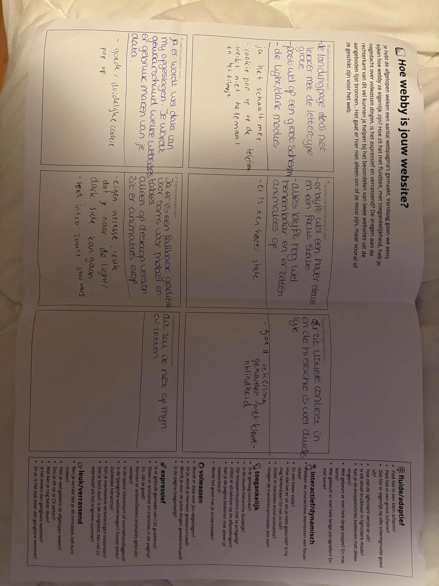.

Hierin hebben we geleerd welke manieren er zijn voor onderzoek doen en welke vragen het beste erbij passen. Dit is iets wat ik eruit heb geleerd.

Voor de lightsaber pagina wilde ik dit iets meer gaan uitbreiden dan alleen build a lightsaber section.
Ik had eerst een radio buttons gedaan met een feieldset in een form tag. maar foor de styling vond ik dit niet fijn werken als je de lightsaber de laser wilde aanpassen. Daarom heb ik ervoor gekozen om dit anders te doen.

Ik heb ten eerst de html aangepast. Ik heb de pagina een background gegeven ik een images van huyang erboven kan doen met nog wat kyber kristals. Door de zwarte achtergrond Zie je duidelijker de andere elementen. daarbij  omdat het om de lightsabers gaat wilde ik images van de kybercrystal om de h1 en de subtekst zetten. Zo krijgt de gebruiker een beeld van wat een kyberkristal is. Ik ehb de radio aangepast naar knoppen met een images van een kyber kristal. Dit is gedaan zodat de gebruiker ziet welke kleuren er zijn en kan er dan op gaan klikken. daarbij vond ik de radio buttons niet zelf fijn werken. Voor het klikken op de knoppen moest ik hiervoor wel de functie aanpassen die de laserstraalt naar voren brengt.

In de javascript haal ik de data op van de buttons die bijvoorbeeld ene straatl en een data-glow heeft. Dit wordt opgehaald in de file en daarna meegeven aan als de knop van een kyberkristal aan is dan geeft hij die kleur mee. Die kleur komt uit de javascript file.

.png).
.png).
.png).

Verder kan je op de afbeeldingen zien dat ik bezig ben geweest met deze pagina.
Daarnaast heb ik deze dag vooral mijn focus gelegt op het schrijven van de learning log.

### Dinsdag 20 Oktober
Op dinsdag ben ik bezig geweest met het maken van
- Character overview pagina
- build a lightsaberpagina

Voor de characters wilde ik een overview pagina maken waardoor je alle characters ziet. Je ziet dan de Jedi counsel op de lightmode en bij de darkside zie je ook de sith counsel.
Hierin heb ik dezelfde heading gemaakt zoals op de homepage. Daarnaast zie je alle characters op beide pagina in dezelfde grid als op de homepagina. Daarnaast is er een knop gemaakt met een functie dat die maar 10 charcters of 8 per keer laatd zien en die toevoegt aan de bestaande characters card.
.png).
.png).
.png).

Daarnaast heb ik een pagina gemaakt waarmee je als gebruiker je eigen lightsaber kan customizen. 
.png).
.png).
.png).
.png).

### Maandag 19 Oktober
Op maandag hadden we na een weekje vrij te zijn weer een drukke dag gehad. 
- feedback gegeven
- Werken aan website
- Lightsaber section maken
- footer toevoegen

Op school hadden we eerste een kleine recap op wat we de week ervoor hebben gedaan. Daarnaats krijgen we ook een stukej uitleg over hoe de laatste sprint week eruit gaat zien en hoe de beoordeling in elkaar zit. Ik heb samen met lysanne aan dehand van een formulier gekeken of mijn websiet wel webby genoeg is. Dit is een formulier die we aan het begin van sprint 1 ook hebben ingevuld. We hadden dit toen gedaan zodat we een beeld krijgen van wat een website nou echt webby maakt. 

We zijn toen gaan kijken naar elkaars website en hebben toen het formulier voor elkaar ingevuld.
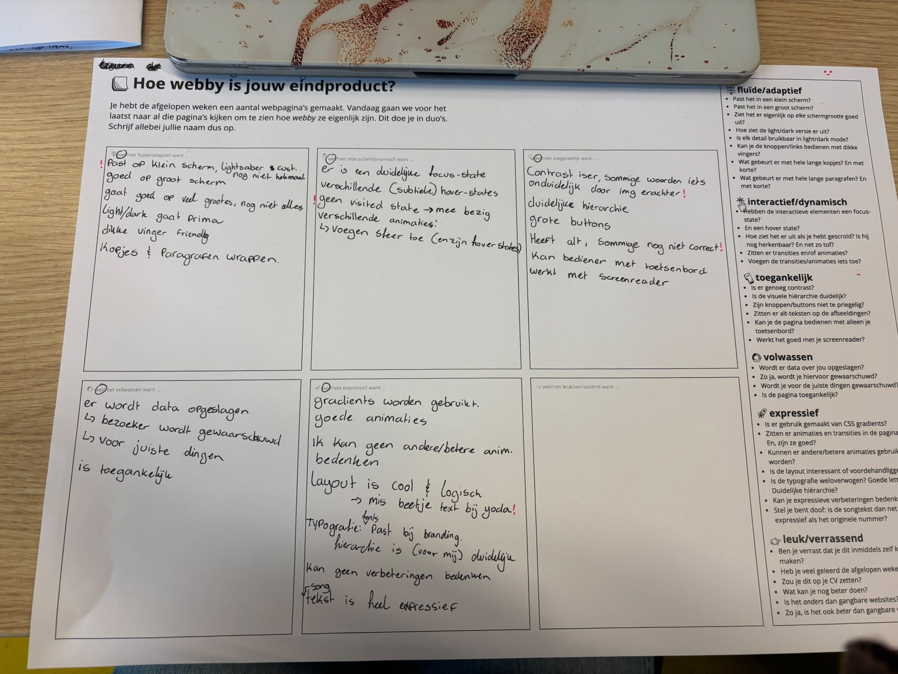.

Daarnaats ben ik gaan verder werken aan mijn webite. Hierbij heb ik een lightsaber section verder gemaakt met ook klikbare lightsabers. Daarnaast heb ik hierbij een animatie gemaakt met de zwevende kyberkristals. Ze bewegen heen en weer.
Ik ehbook de asset van de lightsaber gemaakt in figma.
.png).
.png).
.png).
.png).
.png).

De asset van de figma
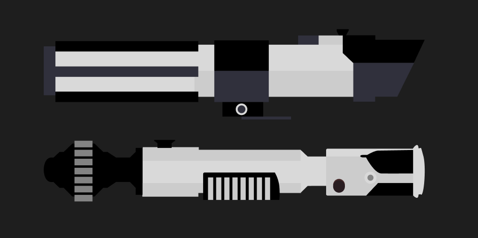.

Ik heb de footer toegevoegt en ook gemaakt in de starwars style. Dit heb ik vervolgens in alle pages gemaakt en geplakt.
.png).
.png).

### Vrijdag 9 oktober
Op vrijdag 9 oktober ben ik bezig geweest met het maken van:
- Deepdive animaties
- Huyang section op de homepagina

In de deepdive hebben we het gehad over hoe je animaties kan maken met css en met javascript.
In de deepdive heb ik 3 opdrachten gedaan waarmee je een een animatie kan starten met eenklein stukej javascript.
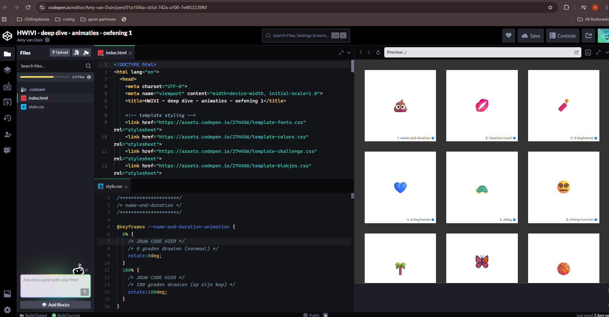.
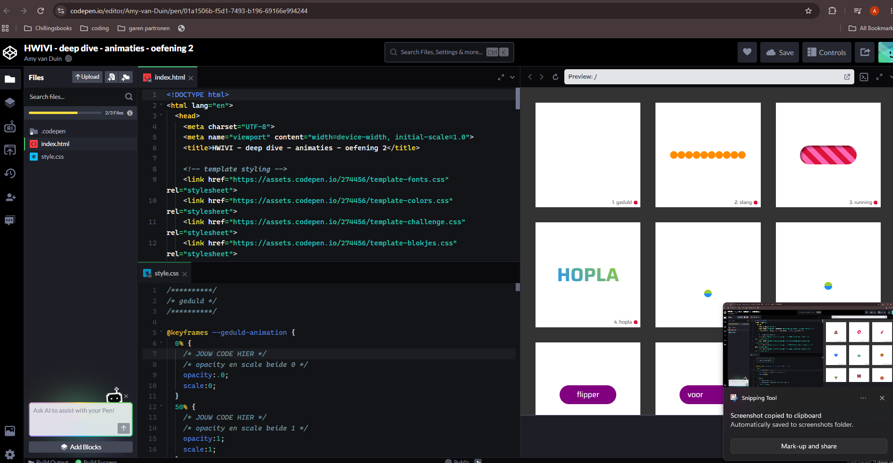.
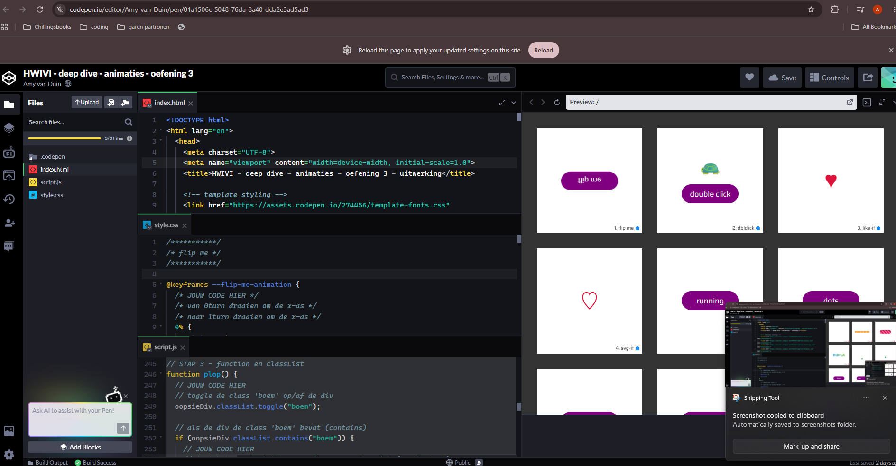.

Hiernaast ben ik verder gaan werken aan mijn website. ik heb een huyang section gemaakt. Huyang is een robot die young padawans dingen leert over lightsabers en hoe je het moet gaan maken. Hiervoor heb ik ervoor gekozen om deze character te gaan gebruiken voor de lightside van de pagina. Ik heb er voor gekozen om eigenlijk de section net zo te stylen als de yoda section om een bepaald onderdeel van de website in et leiden. Ik dacht dit te gaan doen door een character die best wel herkenbaar is onder starwars fans. (Als je ook de series heb gekeken natuurlijk).

Ik wilde om de tekst heen de kyber kristals die de young padawan moeten verzamelen om hun lightsaber te maken. Alleen hiervoor moest ik zelf eerst gaan zoeken naar afbeeldingen van de kyber kristals om dit vervolgens te verwerken in mijn website.
.png).
.png).
.png).

In de codesnippets die je hierboven ziet heb ik een grid ervan gemaakt. Op de section zit een grid zodat de image naast de tekst komt te staan en zodat het voro mobiel onder elkaar komt te staan. De image van Huyang staat een beetje gedraaid zodat het lijkt alsof hij uit het scherm komt om je iets te vertellen over de kristals.

### Donderdag 8 Oktober
Op woensdasg ben ik bezig geweest met het maken van de deepdive Variabelen fonts.
Hierin heb ik geleerd wat variabelen fonts is. Waarvoor het handig is en hoe je het moet gebruiken.
Aan de hand van de opdracht heb ik geleerd hoe je de verschillende lettertype of 1 lettertype kan stylen. daarnaast heb ik geleerd dat je bepaalde animaties kan gebruiken op je lettertype zelf.

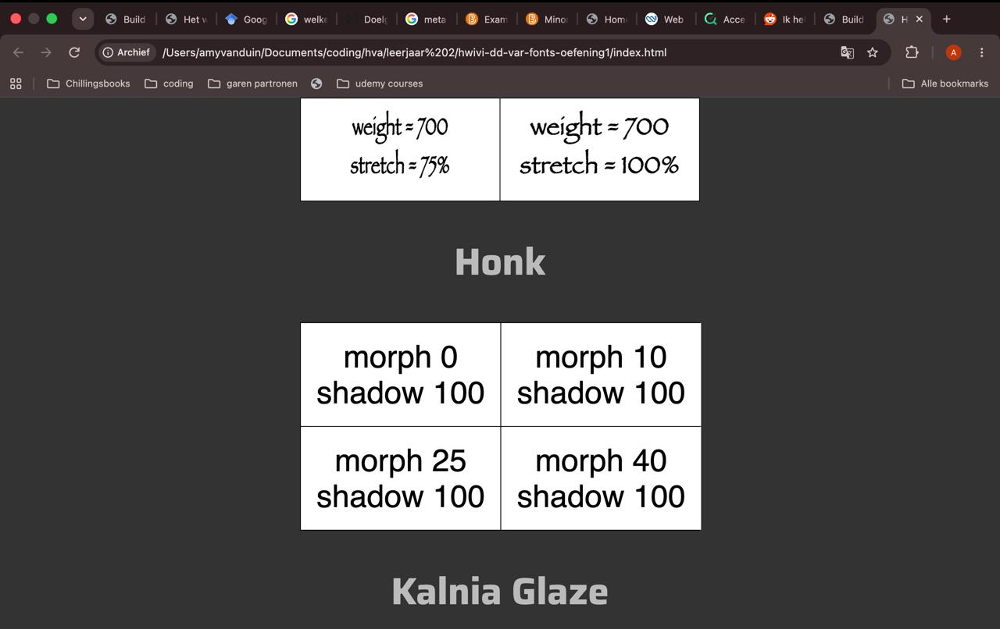.
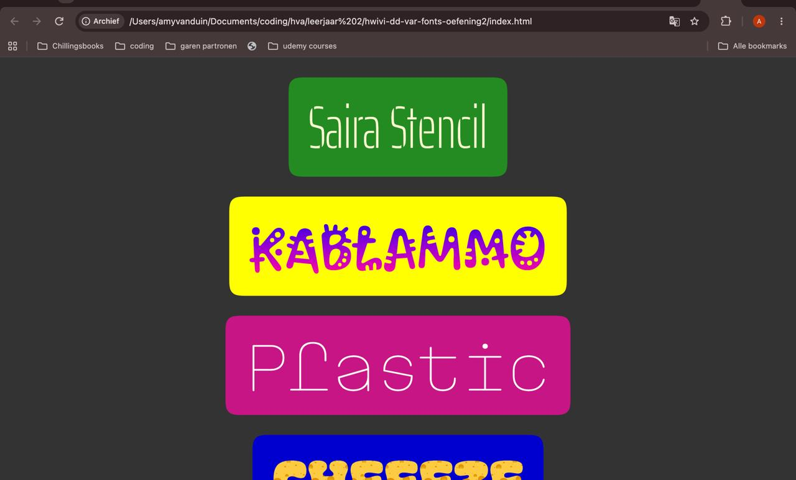.
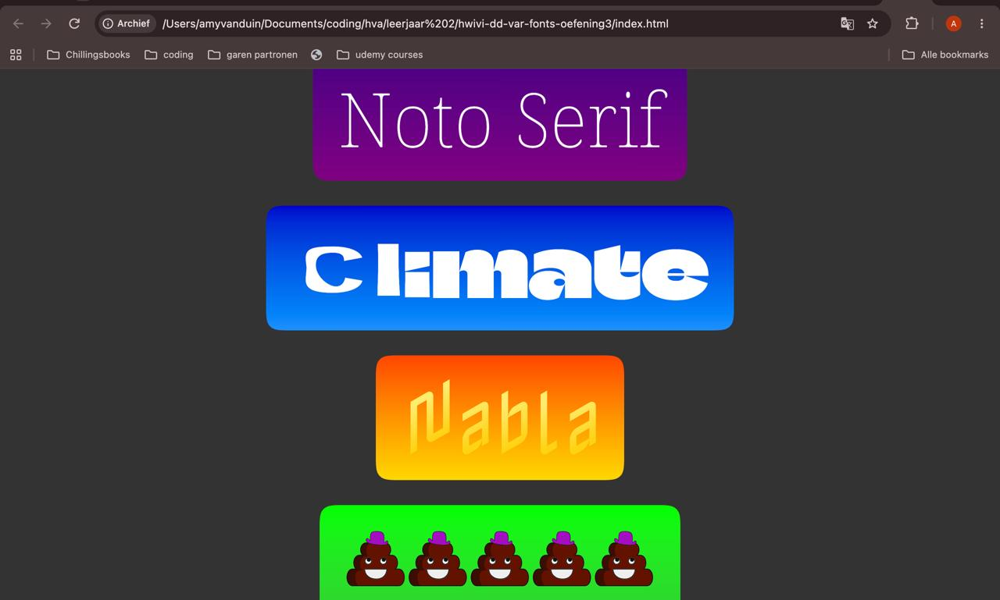.

### Woensdag 7 oktober
Op woensdag ben ik bezig geweest met het maken van twee secties op de homepagina. Ik heb een charactersection gemaakt en ik heb ook de homepagina dark side opgezet met dezelfde code.
Voor de homepage heb ik eerst in figma een soort datapad background gemaakt. Dat heb ik egdaan omdat ik eerst op het internet ben gaan rondkijken of ik dit zelf met css kan doen. Alleen dat was iets dat best wel lastig was. Dus ik heb er toen voor gekozen om er een assets van te maken via figma.

.png).
.png).
.png).
.png).

Dit is een voorbeeld en bewijststuk van het maken van de achtergrond van de datapad. Ik wilde een typische starwars element terug brengen in de website dus ik was aan het kijken oop de officiele website van starwars voor inspiratie. Vervolgens zag ik onder het kopje databank deze kaartjes. Dit moest me laten denken aan een soort id kaart die ook in de clonewars en bad batch werd gebruikt als een identificatie middel van de wezens. daarom wilde ik dit terug brengen in mijn code en design. 

Om dit te maken ben ik gaan kijken naar voorbeelden of mensen die dit al eerder hebben gemaakt. Dit kon je wel doen met een soort clipping mask functie binnen css. Dit zag er echt heel lastig en moeilijk uit voor het tijdsduur dat we hebben voor dit project. Dus ik wilde het gaan proberen en het is niet gelukt. Daarom heb ik ervoor gekozen om dit niet te doen maar een eigen asset te  maken en die als een achtergrond te gebruiken. Voor mobiel en tablet kwam dit heel naar uit dus toen heb ik een grijze background kleur gebruikt voor de sectie. 

Daarnaast heb ik de kaartjes gemaakt in een grid. Ik wilde de kaarten in een grid layout maken omdat dit een stukje makkelijk responsive te maken is en te stylen dan met flexbox. Ik vond dit heel toepasselijk om hier een grid op te gebruiken. De kaarten zijn 75% foto en 25% van het kaartje tekst vlak. Ik wil alleen de eerste character detail page gaan uitwerken als een voorbeeld.

### Dinsdag 6 oktober
Op Dinsdag ben ik vooral bezig geweest met het maken van eht huiswerk en ook het werken aan mijn homepagina.

Eerst ben ik begonnen met het maken van de lyrics opdracht. Vanuit de 10 schetsen die ik de dag hiervoor heb gemaakt heb ik er een van gekozen. 
Vervolgens ben ik dit gaan uitwerken in een aparte file. Hierbij heb ik ook meteen de deep dive Interessantere layouts (Vasilis) gemaakt.
Hieronder zie je het eind resultaat van de lyrics opdracht. Ik heb het simpel gehouden maar wel een beetje expresiief door de verschillende groottes van de teksten.
.png).

Hier is de code uitwerking van de opdracht.
.png).
.png).

Na het maken van de opdracht ben ik uiteindelijk gaan werken aan de opdracht. Ik had nog een feedback puntje dat ik moest gaan veranderen.
De cookiepopup die ik gemaakt daar werkt de gebruiker niet optimaal genoeg informeert om welke cookies er werden gebruikt. 
Ik heb de cookiepopup wat uitgebreid met de informatie van welke services ik gebruik. daarnaast ehb ik ook de linkjes van de bedrijven erbij gedaan en de link naar hun privacy beleid. 
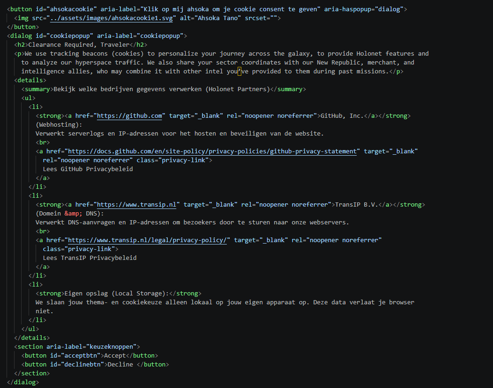.

Hierin heb ik gebruik gemaakt van een summary. Dit heb ik gedaan zodat de gebruiker alleen op een tabje te hoeven klikken en niet een hele grote lap aan tekst heb meteen. Als de gebruiker de informatei willen zien kunnen ze erop gaan klikken. Ik heb ook een klein probleempje opgelost bij de cookiepopup zelf. In de javascript had ik een kleine timer gemaakt waardoor de gebruiker als die 1 seconden op de website belandt / op de homepage belandt een popup krijgt. De gebruiker kan dan niet verder maar kan wel de popup weigeren of accepteren.

### Maandag 5 oktober
Op maandag zijn we begonnen met het derde sprint. Vandaag hebben we de opdracht gdaan om een lyrics uit te beelden met een stukje font.
Ik heb eerst schetsen gemaakt voor de opdracht en ben daarna dit gaan uitwerken.
iN de voorbeeld hieronderz ie je dat ik bezig ben geweest met het schetsen van de opdracht. Hierin ben ik in 10 kleine schetsen het nummer ymca uitgaan beelden.
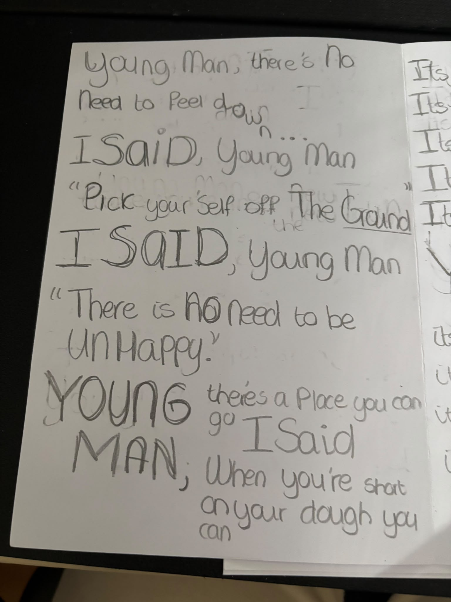.
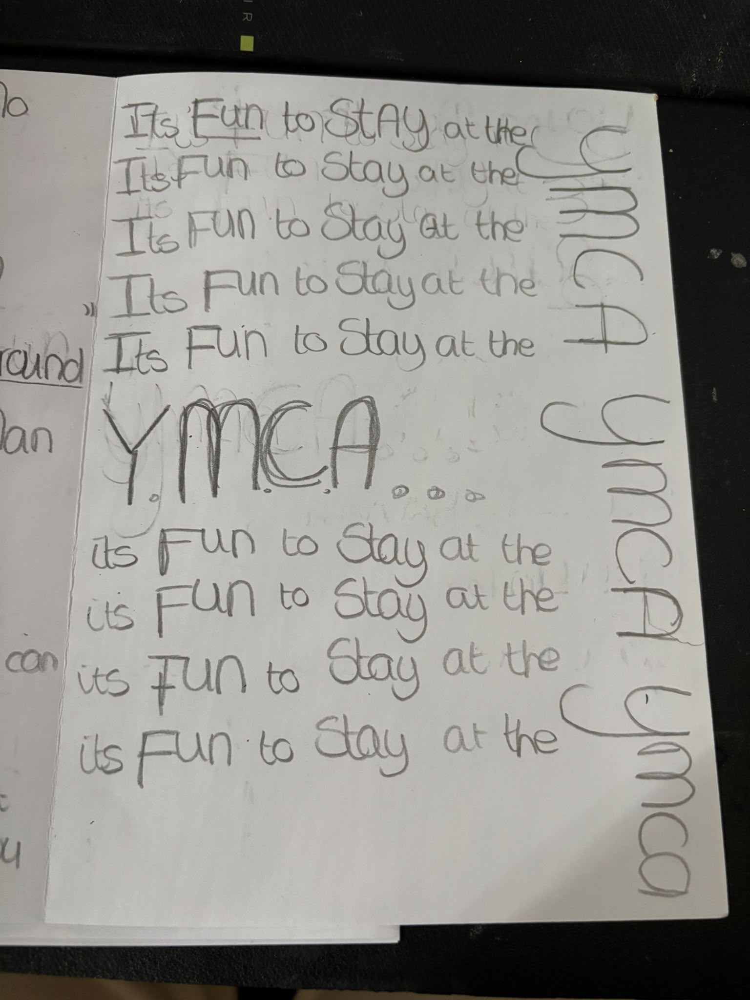.
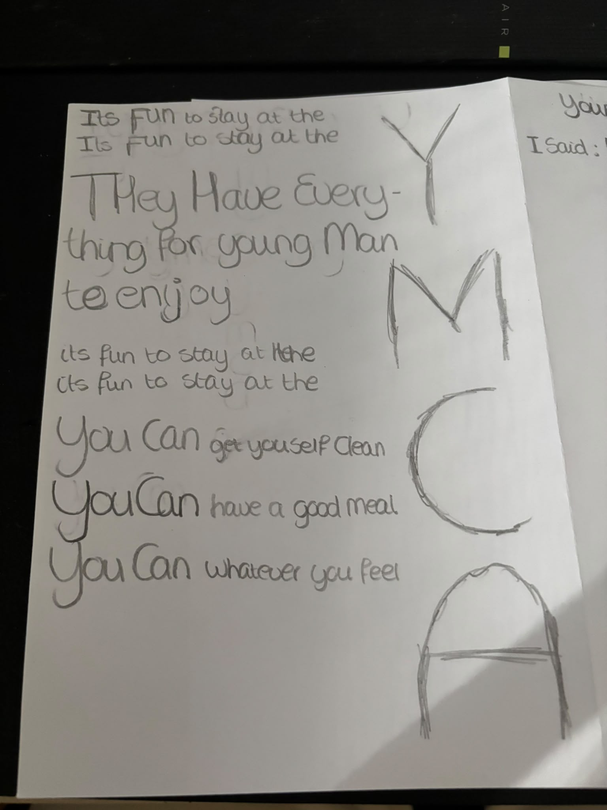.
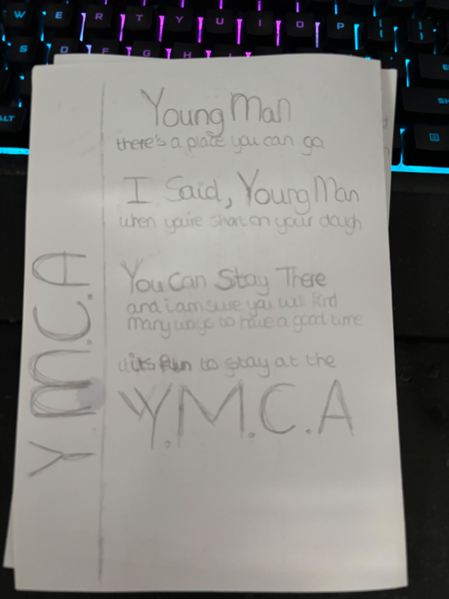.
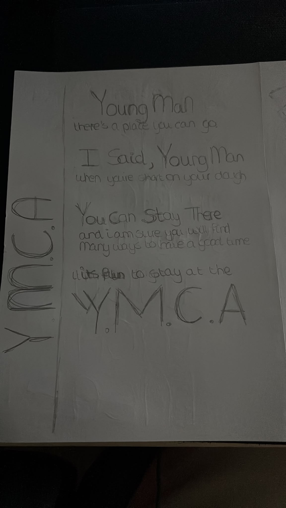.
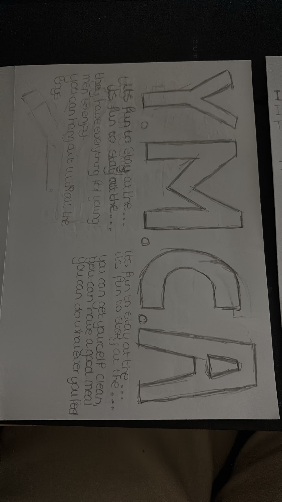.
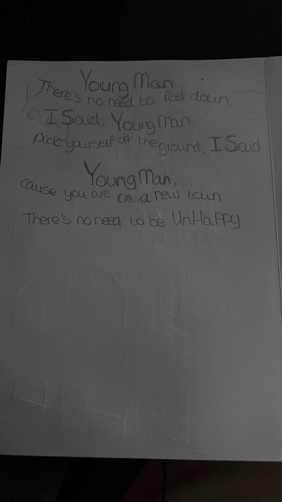.
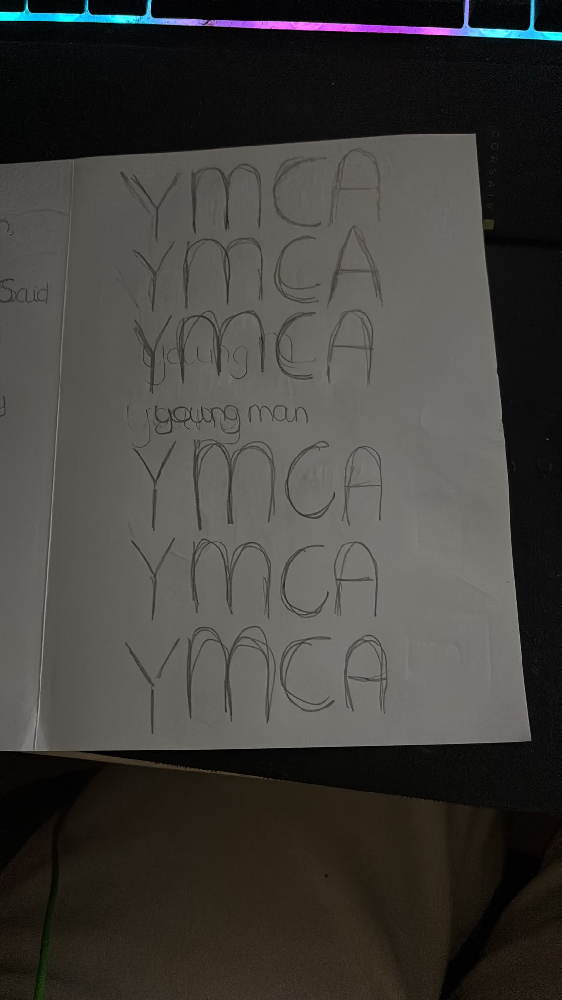.
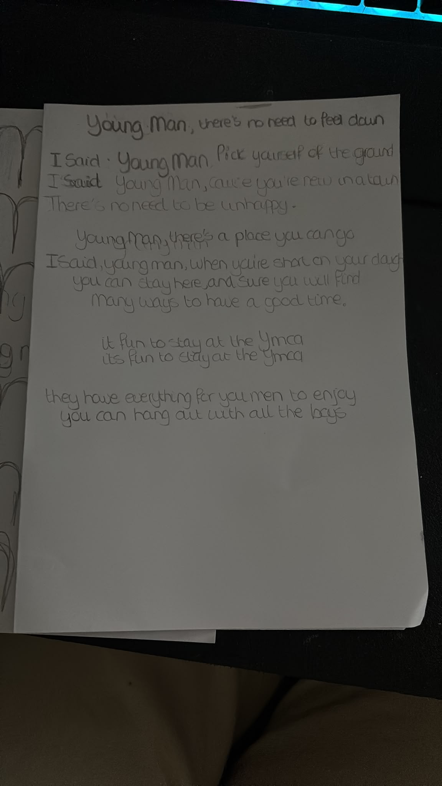.
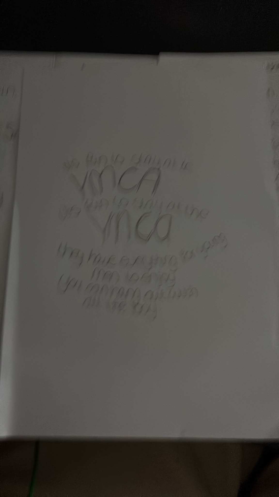.

Voor deze opdracht ben ik bezig geweest met het maken van een opdracht waarin we een artikel moesten lezen over typografie. We moesten eerst in een groep van 4 mensen een artikel gaan lezen. Vervolgens moesten we hier de belangrijkste dingen gaan onderstrepen en die met elkaar overleggen. Daarnaa moesten we dit gaan samenvatten en uitleggen aan een andere groepje met dezelfde artikel alleen het tweede deel. Zo hebben we samen geleerd waarom typografie belangrijk is. We hebben uiteindelijk een korte presentatie moeten houden voor de klas. 
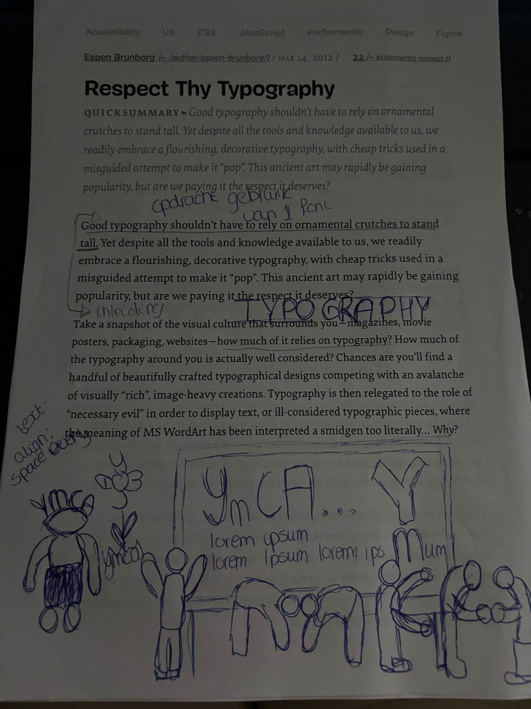.

## checkout
Leg uit wat er met de volgende termen bedoeld wordt: kerning, tracking, leading, flush-left, flush-right, centered, justified, indent, outdent, modular scale, movable type, focus punt, vijf soorten contrast, spatial tension. (Hint, alle termen staan in de artikelen die we samen gelezen hebben).

Kerning: Ruimte tussen twee specifieke letters.

Tracking: Ruimte tussen alle letters in een woord/zin.

Leading: Regelafstand.

Flush-left: Links uitgelijnd.

Flush-right: Rechts uitgelijnd.

Centered: Gecentreerd in het midden.

Justified: Uitgevuld (zowel links als rechts uitgelijnd).

Indent: Inspringen van tekst.

Outdent: Uitspringen van tekst (eerste regel steekt uit).

Modular scale: Harmonieuze verhouding voor lettergroottes.

Movable type: Losse, herbruikbare drukletters.

Focus punt: Waar de aandacht als eerste naartoe gaat in een ontwerp.

Vijf soorten contrast: Contrast in typografie: grootte, gewicht, structuur (lettertype), vorm en kleur.

Spatial tension: Visuele spanning door de afstand en plaatsing van elementen.

Wat is jouw ideale regellengte (measure)? Leg uit waarom.
  ik zou zeggen tussen de 40 tot 66 tekens.

Als je in een ontwerp maar één variabele tot je beschikking had om hiërarchie aan te brengen (grootte, plaatsing, spacing, lettersoorten), welke zou je dan gebruiken en waarom?
Ik zou de specing gaan gebruiken voor de verschillende ruimtes.

### Vrijdag 2 oktober
Op vrijdag hadden we weer een toetsing moment waarbij we were een tekening moesten maken voor de retosspective.
.

Deze dag kreeg ik ook feedback om voor het project meer de punten af te werken om de website toegankelijker te maken en moest ik voor mijn code een tweede pagina maken.
Ik heb deze feedback meteen verwerkt. 
.png).
.png).

### Donderdag 1 oktober
Op donderdag ben ik vooral bezig geweest met het schrijven en het bijhouden van mijn learning log. Ik heb vervolgens verder de test gedaan om te kijken of er verbetering zit in mijn website.
Daaruit kwam dat  er wel wat verbeteringetjes nog zijn maar dat 98% van de website een stuk meer toegankelijker is voor de mensen met een beperking. IK heb het kleurecontrast aangepast en ook de website hierop aangepast
.

### Woensdag 30 september
Op woensdag hebben we op school een test gedaan om te kijken of je met de screenreader wel je eigen website kan bezoeken.
Ik heb de test gemaakt en daaruit kwam er eigenlijk dat hij niet bezocht kon worden voor mensen met een screenreader. Ik heb de uitslagen gekregen uit een test die je kon invullen. 
.

Ik ben hiermee dezelfde dag nog aan de slag mee gegaan om mijn website toegankelijk te maken voor met screenreader.
Ik heb vooral alt teksten en arialabels toegevoegt in mijn html. Eerder maakte ik al gebruik van een goede symmanthiek van me html. Dit hoefde ik namelijk niet aan te passen. 
.
.
.

Daarnaast ben ik ook bezig geweest om mijn popup van de cookieconsent aan te passen. Ik heb er een timer opgezet dar wanneer je door de indexpagina en de theme page door heen bent met  het klikken en je op de homepage komt. Als je 1 seconde op de homepage zit dan krijg je een popup te zien van ahsoka die je de cookieconsent laat zien en dan kan je ook niet verder gaan op de website.
Barbara die gaf me een tip om mijn cookie consent te gaan verbeteren. Ik heb dus ervoor gekozen om het zo te gaan maken waarin ik eigenlijk een functie toevoeg binnen mijn cookieconsent functie.
.

Woensdag 30 sep

Waar staat WCAG en A11y voor? 
Dit zijn voorwaarden om te checken of je website toegankelijk is voor de mensen met een screenreader

Wat vind je lastiger, je laptop/websites alleen met een toetsenbord bedienen of met een screenreader? Waarom? Waar moet je nog mee oefenen?
Ik vind het bedienen van een website op me laptop wel lastig om dit te bedienen met de toetsen en een screen reader. Doordat ik al gewend ben om normaal met een mouse of een trackpad te werken met dit het een stuk lastiger voor mij.

Met welke beperking rekening houden vind je het meest lastig?
Vind je dat je beperkt wordt in wat je kunt ontwerpen?
Of heb je al manieren gevonden om vanuit een solide basis  - die voor iedereen toegankelijk is - allemaal leuke en mooie extra's toe te voegen als je bezoekers dat goed vinden?
Voor animaties en blinden mensen die werken met een screen reader.
Nee door gewoonte vind ik het lastig om te gaan programmeren en te ontwerpen voor mensen met een beperking. Dat komt gewoon omdat ik vaak vanuit mijn eigen perspectief of het perspectief voor iemand die geen beperking heeft.

### dinsdag 29 september
OP deze dag ben ik vooral bezig geweest met het schrijven van code voor de cookieconsent. Omdat op woensdag we de cookieconsent en de toegankelijkkheid van onze website gaan testen. Wilde ik het cookieconsent gaan maken.

Ik heb een cookie consent gemaakt met ahsoka tano als knop. Ik heb een hover gemaakt dta ze eigenlijk als je over haar hen gaat der ogen open zien gaan alsof ze dan wakker word. Vervolgens als je op haar klikt krijg je een tekst balk te zien met een thema tekst van starwars en je eigenlijk het cookie consent ziet.
.
.
.

In de afbeeldingen zie je ook dat ik een javascript file heb gemaakt waarin ik het id van de knoppen ophaal en hieraan een localstorage eraan toevoeg. Ik heb dit gedaan zodat die onthoudt welek keuze de gebruiker gemaakt heeft. Daarnaast heb ik zoals ikn de eerdere deepdives al behandeld is een classlist eraan toegevoegt als je op accepteer klikt dan kan je de rest van de pagina zien. Als je op weiger klikt dan kan je de rest van de pagina niet meer zien.

### Maandag 28 september
Op deze dag ben ik bezig geweest met het maken van :
- een tekening van darth sidoius die je op de dark theme pagina kan vinden.
- darth maul 
- Het doorlezen van het les materiaal
- Ashoka tano image maken in figma
- deepdive meer interactie met html en css

Ik heb deze dag vooral me tijd kwijtgeraakt aan het maken van assets die ik op mijn website kan gebruiken.
Het tekeningen van de elementen en eht maken van de assets die ik wil gebruiken duurt wel lang. Ik heb dper tekening 3/4 uur aaan gezeten en de ahsoka asset ook 3 uurtjes max aangespendeert.
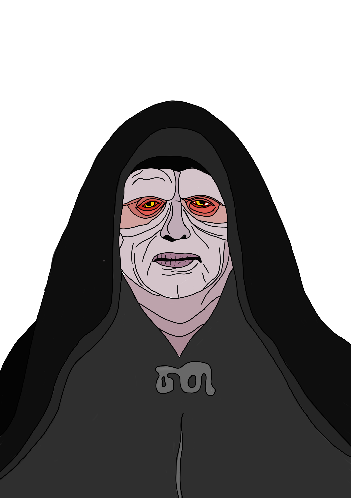.
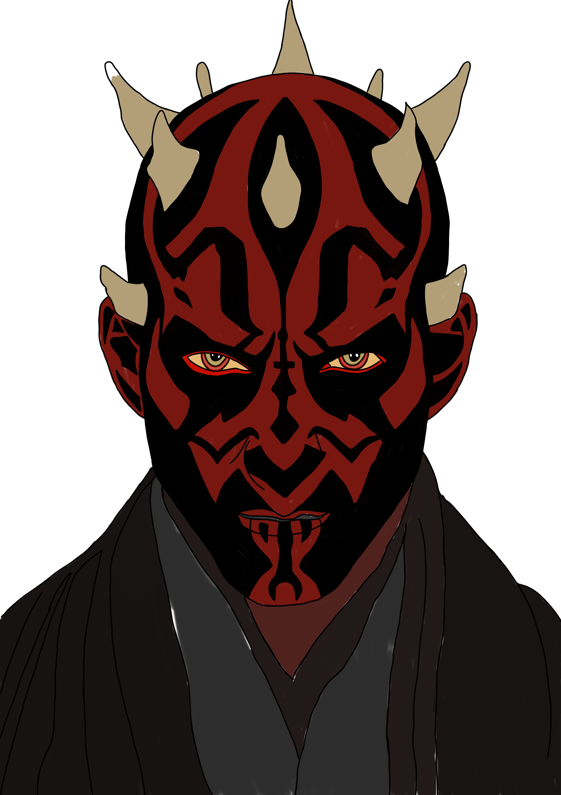.

De asset die ik gemaakt heb van ashoka wilde ik gaan gebruiken voor het cookie consent. Zij was eerst een pada wan van anakin skywalker maar heeft uiteindelijk de jedi order verlaten. Ze is een character die een beetje tussen beide kanten staat en vooral mensen hielp tijdens de tijd dat de empire aan de macht kwam. Daarom heb ik ervoor gekozen om haar als button.
.
.

Om wel op de hoogte te blijven van de kennis die et on sgedeelt word. Ben ik de lesstof gaan doorlezen. Zo krijg ik een idee wat er is gebeurd en ben ik nog wel op de hoogte.

Daarnaast heb ik de deepdive gedaan interactie.
In deze deepdive heb ik de interactie van een form gemaakt. Ik heb deze deepdive niet toegepast in mijn code omdat ik geen formulier wil maken op mijn website.
.

### Vrijdag 25 September
Op vrijdag ben ik bezig geweest met het maken van:
- Huiswerk
- Deepdive
- Tekening van Huyang, Star wars character

Voor het huiswrk voor maandag ben ik mijn consent form gaan schetsen op papier. Ik ben vergeten er een foto van te maken en kan hem hierdoor niet terug vinden. Daarnaast heb ik de artikelen gelezen van de bi-weekly geek 2. Waarin we hebben gelezen over een megarechtzaak tegen meta in de vs. Ook dat chatgpt strengere regels krijgen in de eu waaraan die zich moet voldoen. 

In de deepdive van positions en dialogs Ben ik gaan kijken naar hoe je in je dialog verschillende posities kan aangeven via css. Hierin heb ik geleerd welke typen posities je allemaal hebt:
- sticky
- absolute
- relative
- fixed
- static

Dit heb ik vervolgens toegepast in de volgende oefeningen.
.
.
.

Op deze dag zelf ben ik bezig geweest met het maken van deze tekening voor het gebruiken voor mijn website.
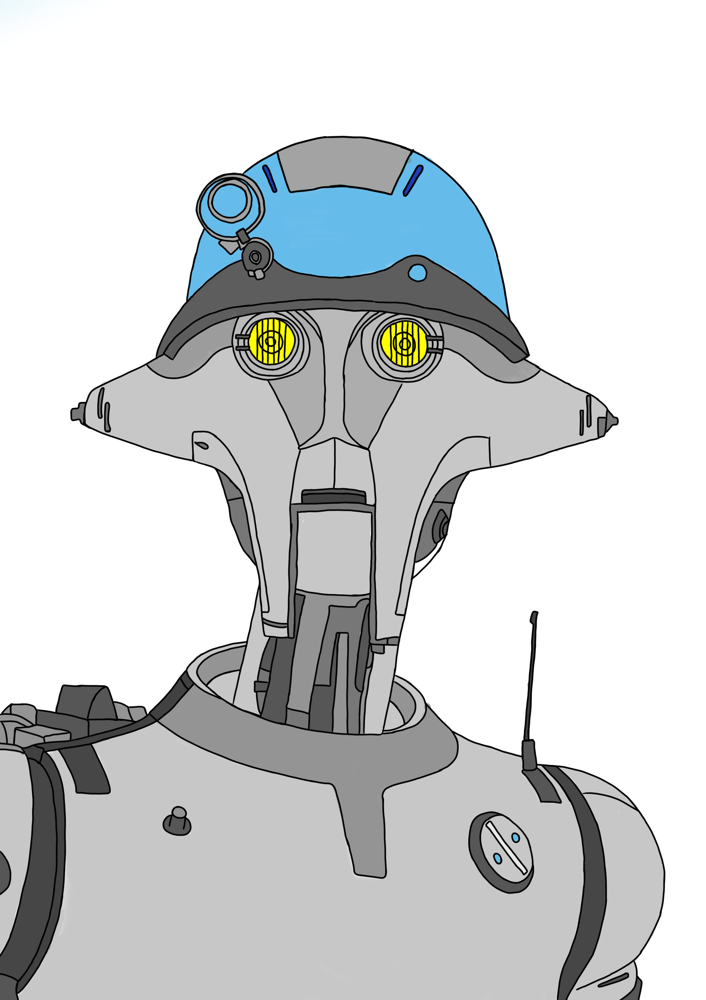.

### Woensdag 23 September
OP woensdag voelde ik mij niet lekker en be hierdoor niet naar school geweest. Maar om niet achter te gaan lopen ben ik wel bezig geweest met het huiswerk en de deepdive die open stond. Ik heb deze dag ook nog een beetje gewerkt aan me navbar in de homepagina.

Voor de deepdive heb ik geleerd om aan de hand van een button actie een style te veranderen. Door de button aan te roepen en ook een class eraan toetevoegen kan ik dit toepassen in mijn eigen code.
Daarnaast weet ik dus nu ook hoe je een dialoog maakt in html en css en javascript. Je maakt een dialoog aan in je html en een button. De button geef je een id mee en die haal je weer op in je js bestand. In je js bestand kan je dan vervolgens de id een variabelen van maken. Die kan je vervolgens een functie van maken die een  classlist toevoegt als de knop in true of false state staat (aan de hand de event click) > De classlist geeft een class mee die je vervolegsn in je css file weer kan stylen.
.
.
.
.
.

Ik heb de styling ietjes verbeterd in me design voor de homepagin aop deze dag.

Wat is een wireflow en wat heb je er aan?
Een wireflow is een tekening van ej website op meerdere schermen. Je kan zo laten zien aan je groepje of je team wat de bedoeling is van de pagina voordat je het gaat uitwerken in een werkende protoype.

Wat zijn dark UX patterns? Geef drie voorbeelden...
- het moeilijk opzeggen van een abbenoment.
Bijvoorbeeld als je een netflix abbenoment heb en je wilt heb stop zetten dan moet je eerst 5 lagen doorgaan voordat je de opzeg knop kan vinden.

- Hiddencost
Aan het einde. van een bestelling bij het afrekenprocess zie je opeens extra kostn die eerder niet duidelijk werden gemaakt

- confirm shaming
Stel je krijgt een popup die je vraagt in te schrijven voor een nieuwsbrief in ruil voor een kortingscode. De knop weigeren zegt " Ik bespaar niet graag" of 'ik betaal liever de volle pot.'. De bedoeling hiervan is om je keuze in twijfel te trekken en je toch over te halen om je in te schrijven.

Waar moet je als ontwerper rekening mee houden bij het maken van een human consent component?
Je koet rekening houden met dat het gebruiksvriendelijk is, Voldoet aan de wet en je gebruikers de keuzes duidelijk laat zien en uitleggen.

### Dinsdag 22 september
Op dinsdag ben ik gaan thuiswerken aan het huiswerk voor woensdag. Ik ben toen bezig geweest met:
- Deepdive: s2- Buttons, states en selectors
- De talk en de artikelen lezen
- Het schetsen van een yoda element
- gewerkt aan de homepagina van me website.

Bij de deepdive heb ik geleerd dat buttons dieje maakt verschillende states hebben. Door de oefening te maken van de codepen heb ik meteen de theorie die mij is gegeeven tijdens de deepdive toegepast.
.

Tijdens het lezen van de artikelen wete ik nu wat drak patterns zijn en hoe ik dit kan voorkomen.
Ik ben ook bezig geweest met het werken aan me project. Ik heb de teksten van beide pagina's dus de header teksten gemaakt en die meteen samen met de header afbeelding responsive gemaakt. Ik ben een overlay over de image gemaakt en daarna hier overheen de teksten laten uitkomen. Ik heb een begin gemaakt aan de navbar die op telefoon afbeeldingen heeft en desktop de teksten met linkejes. Ik heb de navbar gemaakt in een lightsaber en hierin een linear gradient gemaakt die de helft van beide kleuren hebben.
.
.
.
.
.

Daarnaast ben ik begonnen met het schetsen en het maken van een yoda element. EErst wilde ik de afbeelding met photoshop en illustrator maken en dit is uiteindelijk zo uitgekomen. 
.

### Maandag 21 september

Op deze dag ben ik bezig geweest met het maken van een liver version die tijdens de les werd uitgetyped, ben ik verder gaan werken aan me project en zijn we dieper ingeaaan over de cookie popup.
IK heb geleerd hoe je een cookie popup kan analyseren en dit ook kan toepassen. Daarnaast ehb ik geleerd wat dark patterns zijn.
Met de dark patterns zijn we de cookie popups van 3 websites gaan analyseren. (Bekijk de afbeelding hieronder).
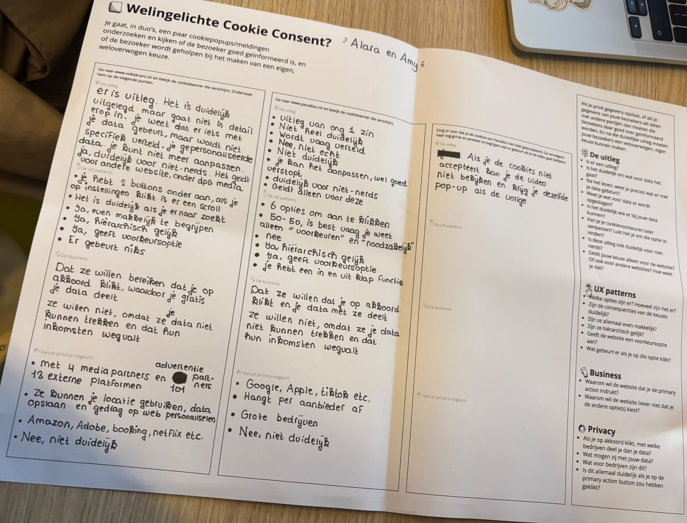.

Tijdens de les hebben we dit gemaakt 
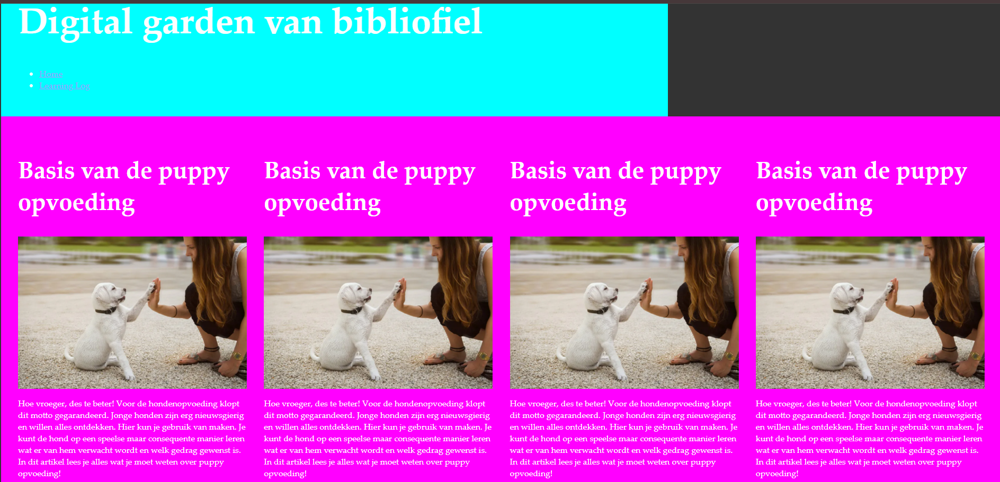.

Ik heb vandaag ook geleerd om te debuggen met code voor mijn digitale tuintje
IK heb namelijk met een merge conflict mijn code van de ladngspage / indexpagina kwijt geraakt.
Ik heb mezelf geleerd om te kijken naar de commits en daarin me code eruit te halen. Zo heb ik uiteindelijk het terug gekregen zoals het vrijdag het op github heb gepushed.

Wat zijn HTML landmark role elements?
De html role elements zijn de volgende tags:
- <head>
- Header
- Main
- Footer
Dit zijn de tags waarmee je de hiërarchie van een website bepaald en de html ook goed indeelt.

Wat zijn heading elementen en hoe horen deze 'genest' te worden?
De heading elements zijn de elementen zoals h1, h2, h3 en p tags waarmee je teksten een bepaalde hiërarchie kan geven in je html.

Hoe ga jij met cookies om? Beschrijf jouw beweegredenen en of die zijn veranderd na het volgen van dit college.
Soms als ik snel een website bezoek dan negeer ik al standaard de de cookies en accepteer ik deze niet. Ik heb nooit uitgebreid alles gelezen en zal dat ook niet gaan doen. Tijd kost nou eenmaal geld en veel tijd hebben we niet om alles door te lezen wat er met me data wordt gedaan. Ik zal wel alles meenemen in het maken van een website maar niet bij het gebruik van een website.

### Vrijdag 18 September
In de retrospective ben ik bezig geweest met het maken van een schets en het in beeld brengen van mijn proces. Hieronder vind je hoe ik mijn proces van sprint 1 heb ervaren.
Je krijgt makkelijk een beeld van wat een goede retrospective tekening is en ik heb dit verwerkt doormiddel van een tekning die ej hieronder kan vinden. 

De retospective van vrijdag
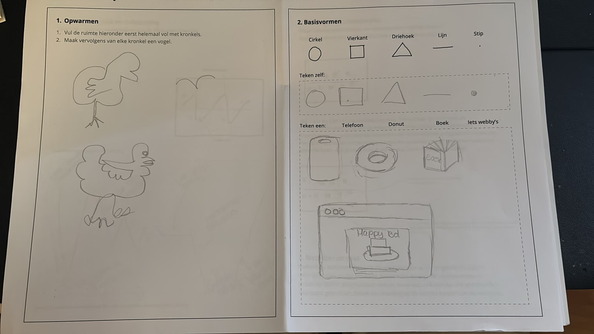.
.
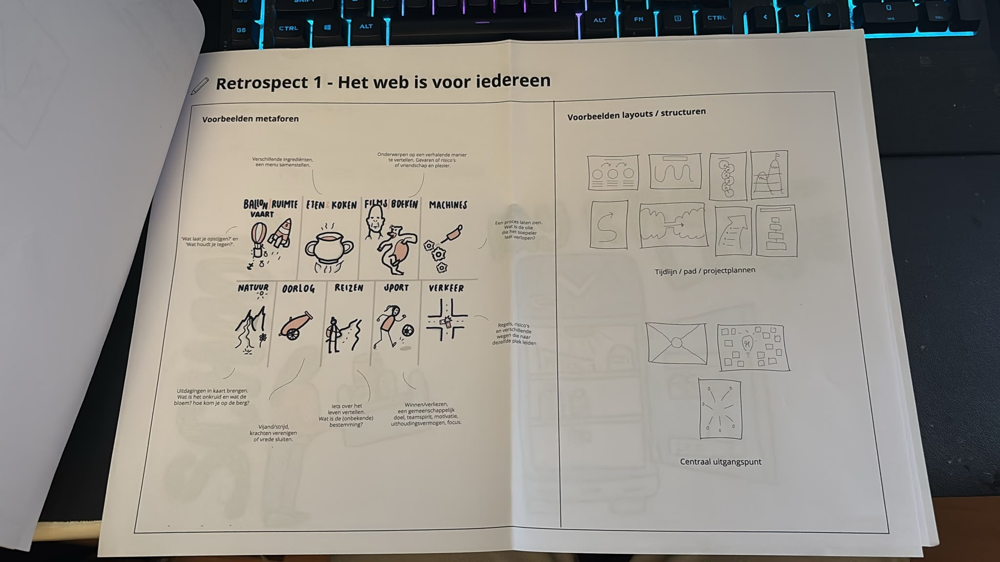.
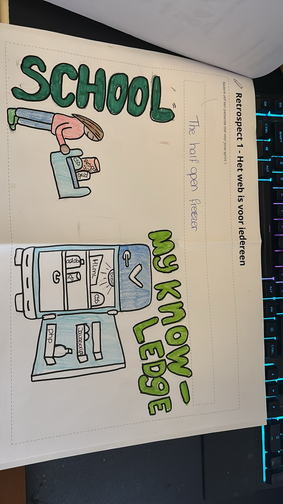.

Daarnaast hebben we ook retrospective gesprekken gehad waarin we hebben gekeken wat er verbeterd kan worden zowel in mijn process, learning log en mijn code.
Ik heb het naar mijn verwachting veel beter gedaan. De feedback die ik heb gekregen
- Het beter bijhoduen van me learning log
- design / schetsen erin zetten
- stukjes code toevoegen in mijn learning log

## orienteren en begrijpen
Waarom geven de docenten deze opdracht?
Ze willen dat we leren te coderen. Want later als je wilt gaan samen werken met codeurs / programmers dan weet je waar je over kan praten 

Welke technieken gebruik ik?
Ik maak gebruik van html, css en javascript. Ik heb mij digital garden gemaakt met html en css en daar een klein beetje javascript bij voor de theme function. Zo kon ik de theme buttons doorlinken aan de juiste thema. 

Wat zijn de randvoorwaarden?
Allereerst zijn er een aantal algemene randvoorwaarden waar je werk en proces aan moeten voldoen om in aanmerking te komen voor een voldoende beoordeling:

Je website staat tijdig op GitHub en werkt zonder fouten.
Je hebt voortgang besproken tijdens de voortgangsgesprekken.
Je hebt jouw proces inzichtelijk vastgelegd.
Je hebt je bronnen vermeld in je learning log en code.
Je hebt je werk zelf gemaakt*.
Je kunt keuzes/ideeën/code uitleggen.
Je hebt zelf nette code** geschreven.

Waar gebruik je HTML/CSS voor?
De html zorgt voor inhoud en de structuur. Je gebruikt het om te bepalen waar tekst, kopjes, afbeeldingen,labellen en knoppen op een webpagina.
Css zorgt voor  uitstraling en het uiterlijk voor  website. 

Wat kan er allemaal met CSS?
Met css heb je verschillende mogelijkheden hebben qua styling. Zo heb je color properties waarmee je gemakklijk een kleur kan aanroepen ipv dat je telkens de kleur code met oproepen. Dat geldt het zelfde voor custom fonts. Het beste is om 1 file te maken en deze kan je altijd importeren in verschillende style sheets. Je hebt ook de transition properties waarmee je dus dingen op de website kan animeren.

## verbeelden en conceptualiseren

Lukt het om verschillende ideeën te bedenken?
jaa het lukt wel om twee verschillende ideeën qua design te maken.

Lukt het om je ideeën te schetsen?
Ja het lukt wel met het schetsen op basis van me concept en het ideeën te verwerken erin. ik probeer in me schetsen duidelijk de starwars style naar voren te brengen.

Wat doet deze CSS-property?
je kan met verschillende properties verschillende dingen bereiken. Bijvoorbeeld mset css kan ej animaties, styling en mobiele websites maken. 
Met de properties kan ej dus meer dingen doen dan je denkt. Je kan dus alles maken wat ej maar kan bedenken.

Welke content, en welke HTML heb ik nodig?
Als je een html pagina wilt maken heb je natuurlijk content nodig. Dit kan je gaan schrijven i een html symmatieke manier van schrijven. 
Dat betekend dat je in je html file alles inzet wat je wilt hebben op je website.

Hoe kan ik dit soort content vormgeven?
Je kan dit soort contnt vormgeven doormiddel van een css style sheet. Dit is ee file waar al je design keuzes in komt te staan. Dit is eigenlijk de jas op je html. Het uiterlijk van je website.
Je kan dit maken door de stylesheet te linken aan je html-pagina. Zo krijg je kale html pagina een nieuwe uiterlijk.

Wat als ik hier nu eens 1000 invul?
Het tekenen en het schalen van je elementen per apparaat is heel belangrijk natuurlijk. Als je website te groot is voor bezoeker die op hun telefoon zitten dan is dast natuurlijk niet fijn.
dat is natuurlijk ook niet fijn als het andersom zo zijn. 
Daarom is het heel erg belangrijk dat je tijdens het verbeelden en conceptualiseren per apparaat alles goed schaalt en hier goed over nadenkt.

## Prototype en uitwerken
Begrijpen bezoekers de site?
Voor het uitbrengen van je website is het heel erg belangrijk dta je eerts begint met testen. Zo kan je kijken of je website voldoet aan een prettige ux ervaring.
Gebruikers komen niet op je website als de ervaring niet goed of fijn is. Daarom is het testen met de doelgroep hele belangrijk. Zo kan je dingen veranderen waar de gebruiker tegen aan loopt of niet fijn werkt. Zo krijg je uiteindelijk veel meer bezoekers op je website.

Wat vindt de opdrachtgever er van?
Vaak is het testen met en opdrachtgever heel verlichtend. Dit is je moment juist om aan de opdrachtgever te laten zien wat je gemaakt heb. Daarnaast zie je wat de opdrachtgever vind van wat je gemaakt heb.
Daarnaast is het testen voordat je naar een opdrachtgever gaat ook heel belangrijk is. Zo kan je zeker weten of je werk het goed doet voordta je iets gaat opleveren.

Werkt dit wel?
Je moet altijd testen wat je maakt. Zo weet je of de functionaliteiten die je maakt ook meteen werken. Dit is belangrijk want dan hoef je niet last minute alles te gaan testen in je project en kan je het meteen debuggen.

Oooooh, kan dit óók?!
Door het protetype en het testen kom je er vaak ook achter wat wel werkt en hoe je iets kan verbeteren. Dit geldt ook voor je css file en je coe hiervan. Je kan altijd met de feedback van anderen altijd leren en jezelf verbeteren.

## Evalueren
Reflecteren met the riddle:
Reflecteren si heel erg belangrijk. Omdat ik nog niet heel erg ver ben mety me project kan ik nog moeilijk evalueren op wat ik gemaakt heb. Ik kan wel het gaan evalueren op mijn process dta ik in de eerste sprint van twee weken gedaan heb. Aan de hand van de vragen kan ik mezelf iets bewuster maken van mijn process.

Wat wil(de) ik weten/bereiken?
Ik wil een functionele website kunnen maken in html en css. Hierbij wil ik ook een klein beetje javascript kunnen maken en dit terugkoppelen aan mijn code. Ik heb deze sprint geleerd hoe je op een andere manier kan gaan stylen en een mobiele versie eerst maken.

Wat heb ik gedaan?
Ik heb in deze sprint een theme choise page kunnen maken. een light/darkmode, een gradient button op hover, een tekst scrol animatie en met javascript heb ik de light en darkmode gemaakt waarmee die onthoudt wat je hebt gekozen met een localstorage. Dit is iets wat ik heb geleerd en dit heb toegepast op mijn digital garden over whatsapp.

Wat was het resultaat?
Ik heb eerst een beetje ermee moeten struggelen. Uitiendelijk is het me wel gelukt om dit toe tepassen. Ik heb ook geleerd op een andere manier te coderen en alles wat ik gewend ben moet ik effe loslaten en het nieuwe ervaren. 

Wat weet je nu (niet)?
Ik moet nog mijn teksten kunnen veranderen op basis van het thema. 

Wat vond je (niet) leuk?
Ik vond het concept wel lastig o met een concept te komen die ik zelf heel leuk vind om te maken. Hier heb ik een beetje mee gestruggled en ging het ook echt lastig mee.

Voldoet het nog aan de eisen?
Na kijken van eisen en de sprint review gesprek/ retrospective ben ik wel op een goede richting. Ik heb het evaluaren nog niet gedaan en het echte prototype van me code nog niet.

### Woensdag 15 september
Op woensdag zijn we bezig geweest met he verversen van je design en daar een nieuwe blik erop tegeven.
In een groepje van 4 keken we naar het design van elkaar en konden we hierop een nieuwe maken. Dit was de opdracht 18 tot 20.
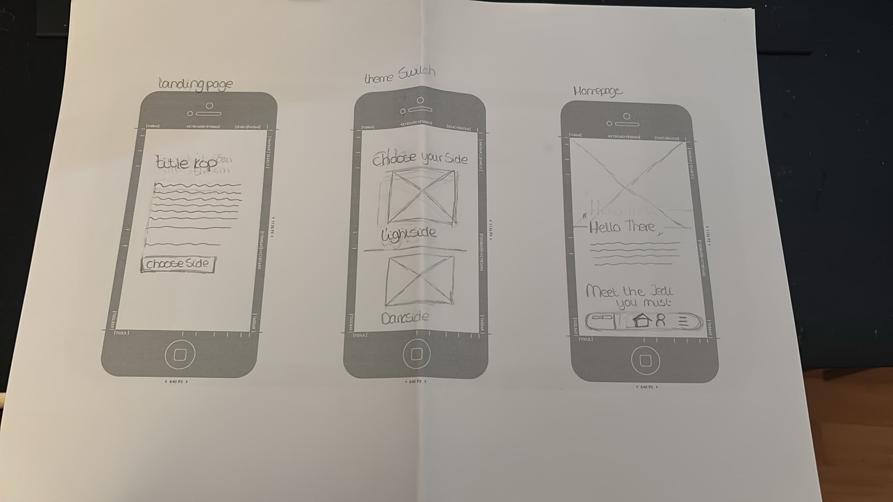.
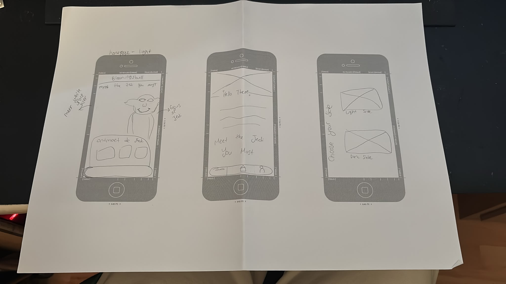.
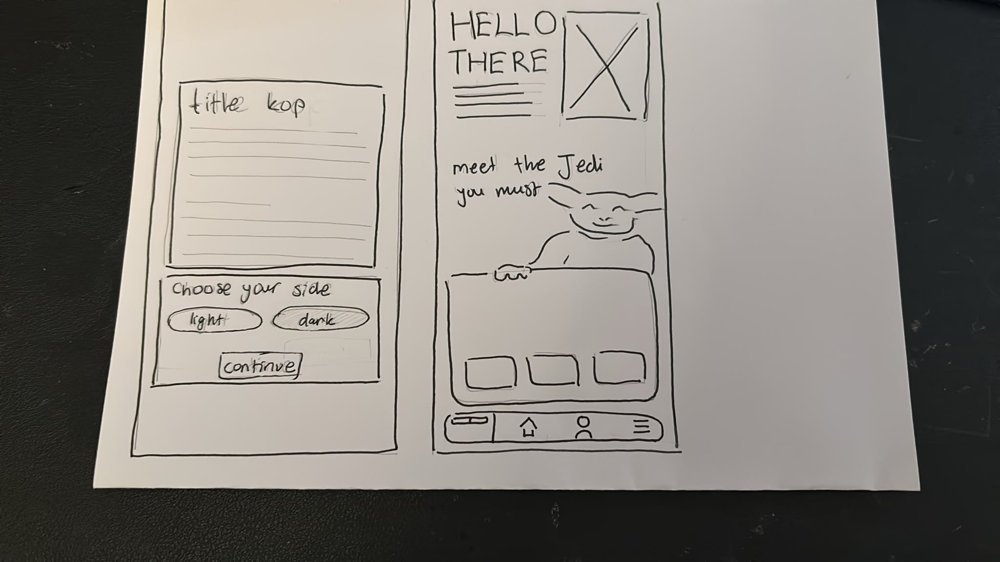.

WE hebben geleert wat de gestaltprincipes zijn en wat nou een grid is en hoe je dit kan toepassen in je code.
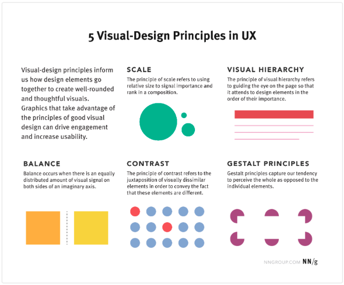
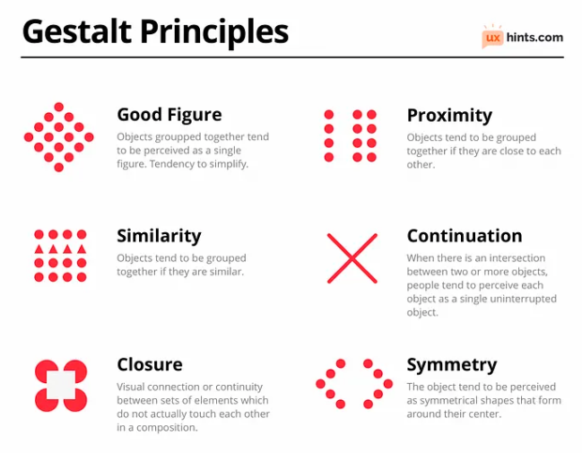

## checkout
Symmetry 
Brengt dingen goed samen en is hetzelfde styling

Nabijheid 
Het dicht opeen staans van elementen op een website

Witruimte
Dat er genoeg speling is tussen objecten op een website

Vraag 2
Dat er dingen goed te plaatsen en met te spelen zijn.
De websites elementen kan je makkelijk responsie maken.

Vraag 3
De witruimte en de Similarity. De ruimte is heel belangrijk in de websie want dan zijn elementen iets zichtbaarder

### Maandag 14 September
OP maandag hebben we in groepjes het gehad over de vormen van researching. We kregen in de les een blad met een Hoofdvraag daarop. Hierin moesten we deelvragen bedenken die het beste het onderwerp zouden beantwoorden. 
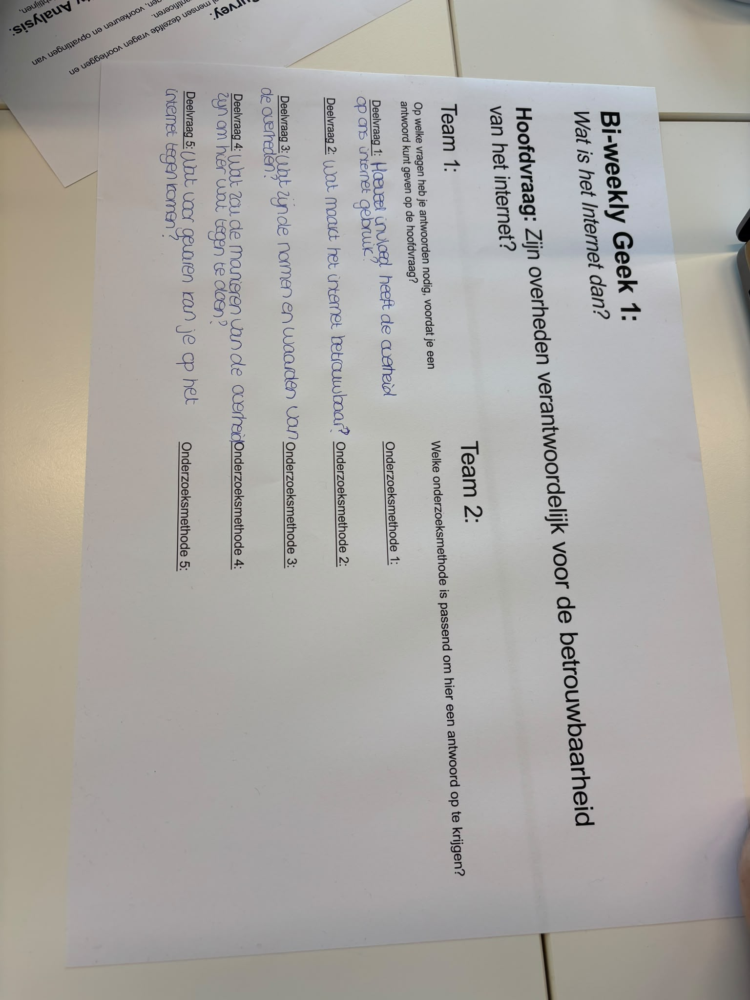

Op de foto zie je dat we de deelvragen hadden behandeld. De bladen werden omgewisself met een andere groepje. Bij hun vragen hebben de bijpassende onderzoeksmethoden besproken en opgeschreven. Zo wisten we welke onderzoeksmethode je hierop kan aansluiten en in welke scenario je dit kan toepassen.
 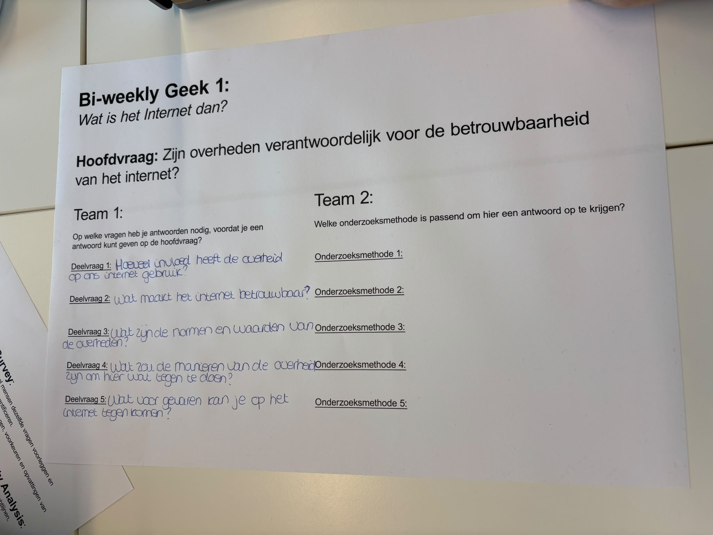.

Leg uit wanneer een website 'lelijk' wordt en geef voorbeelden wat je kan doen om deze 'lelijke' onderdelen te fixen?
Als elementen niet responsive zijn en alle afbeeldingen geen goeie grote hebben. En ook dat de styling niet bij elkaar past.
Je kutn mediaqueries gebruiken en in je code de website al een stuk responsive maken (Zoals het werken met procenten.)

Vertel welke volgende stap je neemt om je website responsive te maken.
Je moet eerst voor mobiel gaan designen dan pas naar de web versie.

Kun je het ontwerp en de bouw van je eigen Garden (zo uit je hoofd) onderbouwen in Webby vocabulair?
Ik maak me website meteen mobil first klaar.

### Vrijdag 11 september
Op vrijdag ben ik bezig geweest met het maken van de deep dive opdracht. In de deep dive opdracht van Sanne heb ik geleerd wat grid is en de children properties die je kan gebruiken om een grid item te stylen. Aan de hand van de oefeningen hieronder (De afbeeldingen als bewijs) zie je dat ik de stof heb opgenomen en dit heb toegepast in de code.
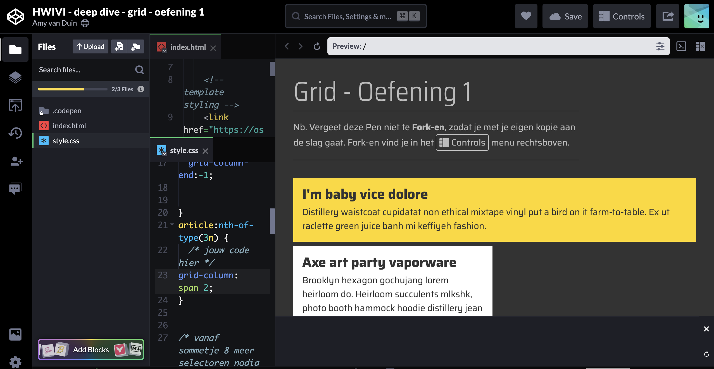.
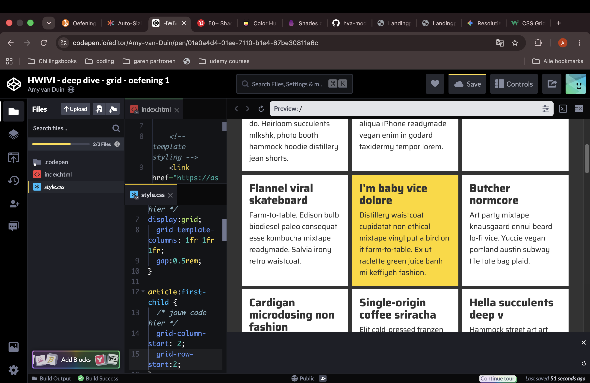.
.
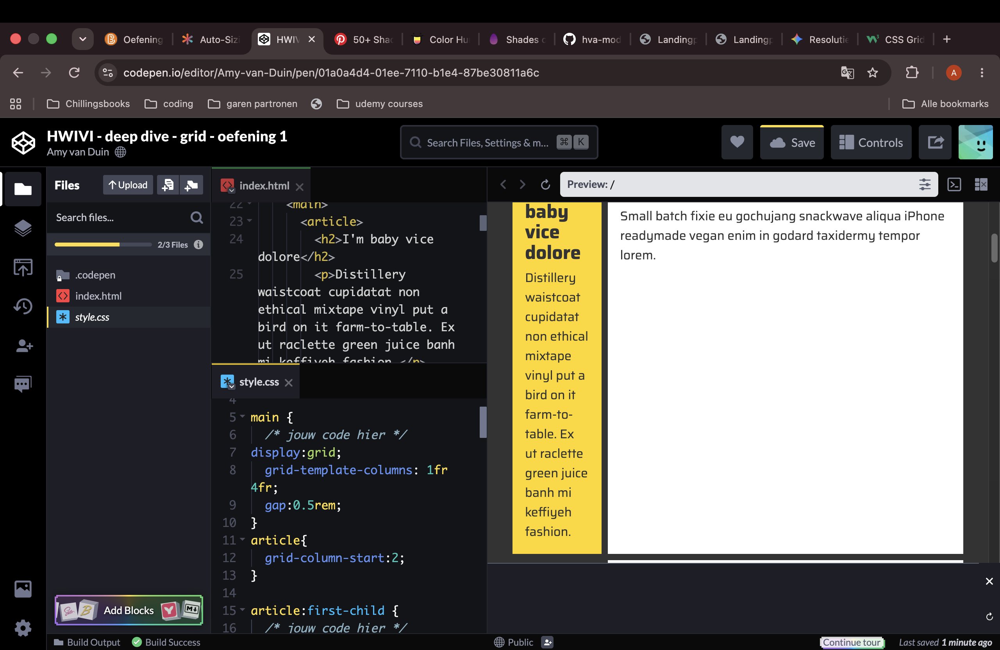.
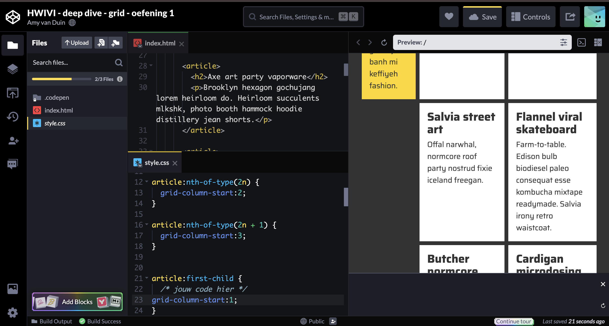.
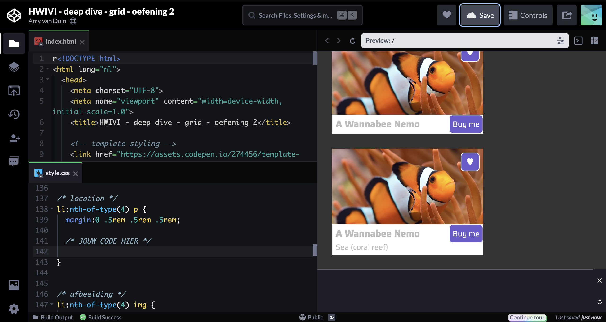.
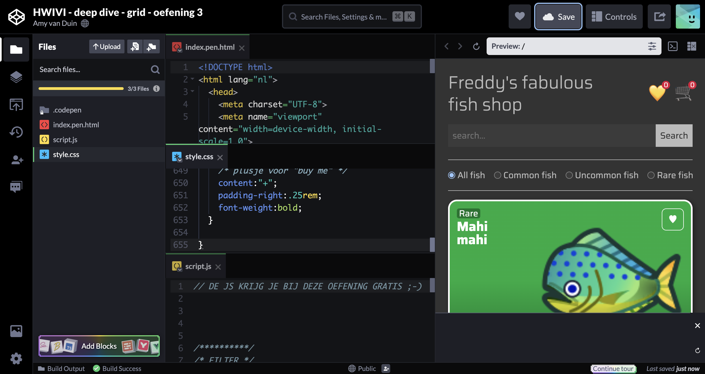.

### donderdag 10 september 2026
 Op deze thuiswerk dag ben ik gaan werken aan het huiswerk dat we gekregen hadden.
 - Schetsen verder afmaken
 - Mooie kleuren, gradients en patronen

Voor de Deepdive Mooie kleuren, gradients en patronen heb ik eleerd hoe je verschillende gradienst kan maken.

Dit was de eerts eoefening waarbij we 6 verschillende soorten gradients moesten namken. Hierin heb ik geleerd dat je verschillende soorten gradiensts heb en ze ook samen kan voegen. In deze oefening heb ik eerst de gradients geoefend.

De verschillende soorten gradients die je hebt:
- linear gradient
- radial gradient
- conic gradient
- repeating linear gradient
- repeating radial gradient
- repeating conic gradient

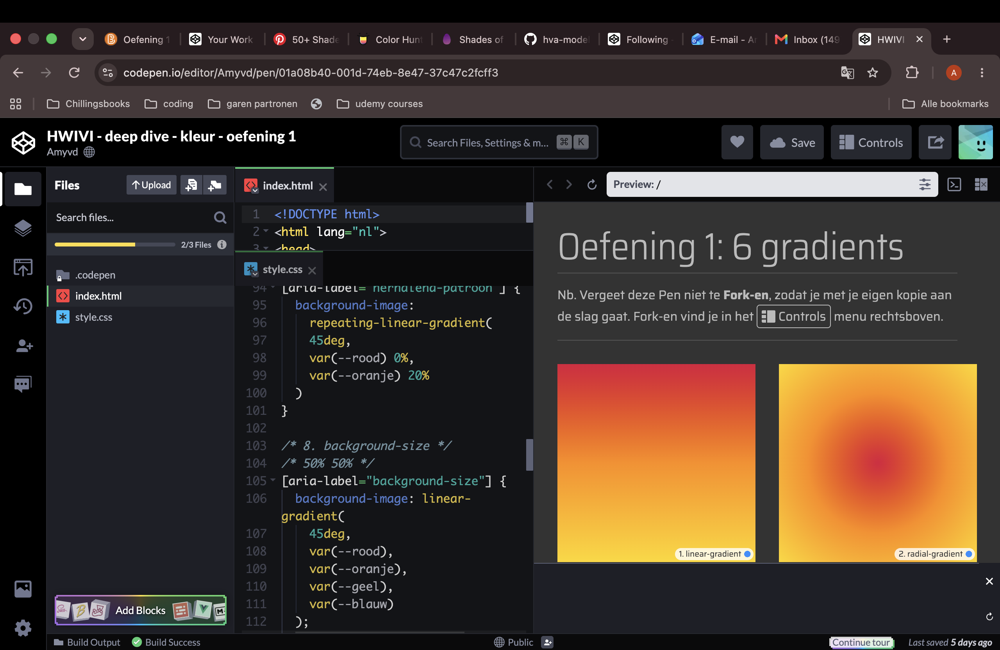.

In de oefening die je hieronder ziet heb ik geleerd om de verschillende soorten gradienst op elkaar te stappelen. Hieronder heb ik in de opdracht een vlag moeten namaken met css.
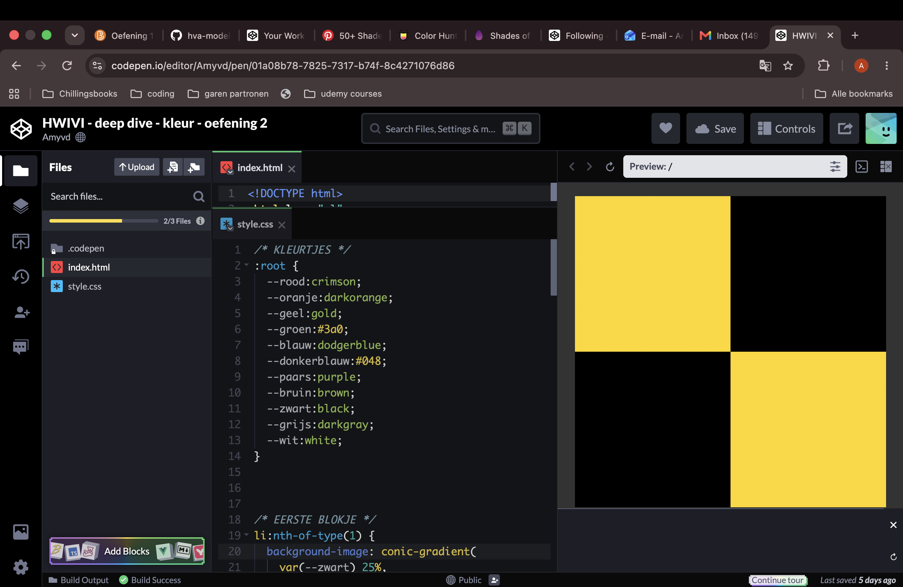.
.

In de opdracht hieronder kan je de gradient ook een transition geven. Ik heb dus geleerd om de gradient ook te kunnen animeren met de transition en transform.
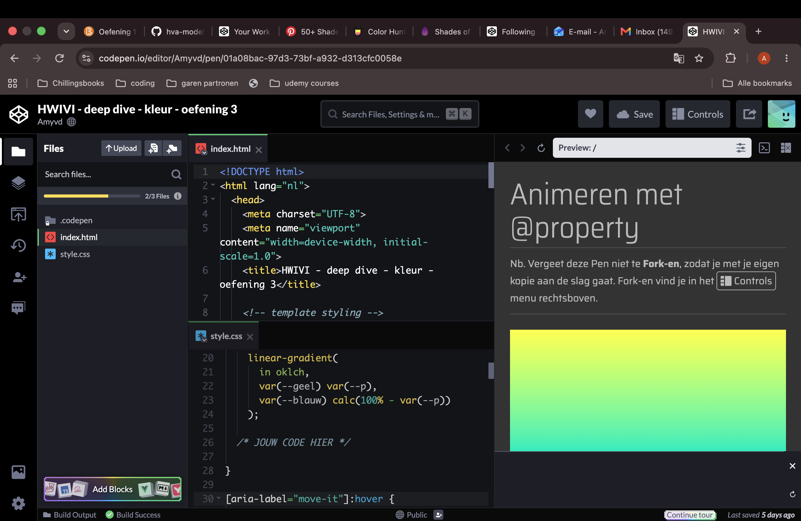.

### 9 september 2026
Op woensdag 9 september was er een staking met het ov. Hierdoor was er een online les en hebben we de volgende dingen behandeld
- presenteren van presentatie over onderwerp
- Visual Research maken
- De crazy 8
- De checkout

In het eerste gedeelte van de dag heb ik samen met analot de presentaties gedaan. We moesten in twee tallen de presentatie maken en wat vragen beantwoorden
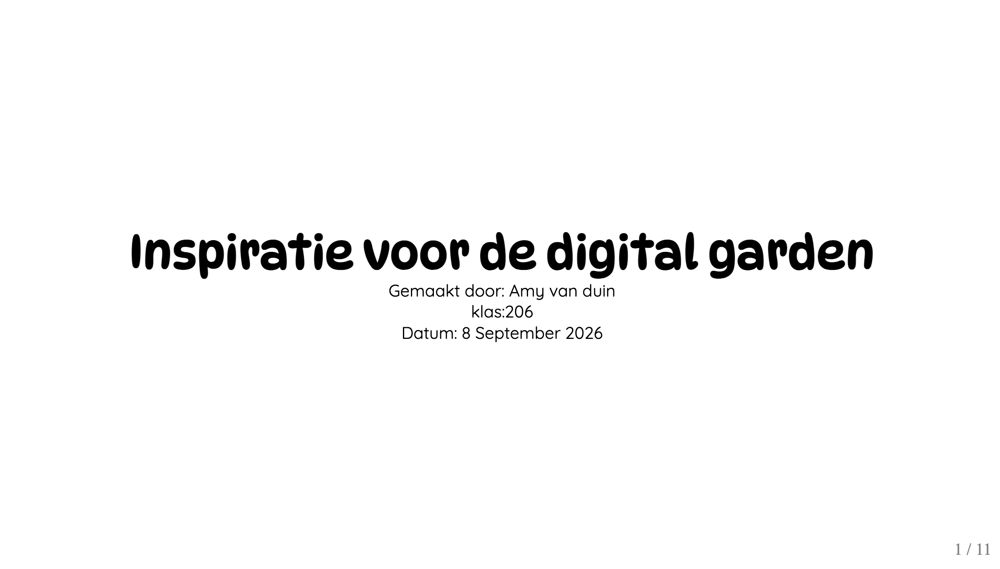.

# De vragen van de presentatie
Wat is voor jou de essentie van wat je hebt gepresenteerd qua onderwerp en geschreven/beeldende content?
De essentie is voor mij dat matcha meer is dan alleen een populair groen drankje. Ik wil de combinatie laten zien tussen de traditionele Japanse cultuur en het vakmanschap achter matcha en de moderne matchacultuur van nu. In mijn beelden komt vooral de bereiding, het matchapoeder, de materialen, beweging en de groene uitstraling terug.
 
Welke woorden uit de kwaliteitenlijst kunnen passen bij je onderwerp?
Woorden die goed bij mijn onderwerp passen zijn: rustgevend, natuurlijk, verfijnd, traditioneel, modern, fris, minimalistisch, zacht, stijlvol en ambachtelijk.
 
Heeft ‘de ander’ een aanvulling op je onderwerp?
Amy zei dat ze het leuk vind dat ik echt de wereld achter matcha wil laten zien. Zodat mensen het drankje niet alleen nemen omdat het een hype is maar omdat het ook echt voor iets staat.
 
Wat is het karakter/de uitstraling/het gevoel dat bij het onderwerp past?
Het gevoel dat ik bij mijn onderwerp wil neerzetten is vooral rustig, natuurlijk, fris en verfijnd. Tegelijkertijd wil ik dat het modern en stijlvol aanvoelt. De traditionele Japanse kant zorgt voor rust en vakmanschap, terwijl de moderne matchacultuur het wat speelser en eigentijdser maakt.
 
Welke inspiratie kun je uit de afbeeldingen halen? Stijl, gevoel, vorm, enz.?
Uit mijn afbeeldingen haal ik vooral inspiratie uit de groene en natuurlijke kleuren, organische vormen en structuren van het matchapoeder. Ook beweging komt veel terug, bijvoorbeeld bij het kloppen, schenken en mengen van matcha. De beelden voelen rustig en minimalistisch, maar tegelijkertijd modern. Voor mijn Digital Garden wil ik daarom veel werken met groentinten, wit/crème, grote beelden, ronde en organische vormen en een rustige vormgeving.

Wat zou je willen vertellen over het onderwerp aan een ander? En hoe zou je dat voor je kunnen zien? Middels welke beeld, tekst, animatie, inhoudelijke content?
Ik wil dit vooral visueel laten zien met veel afbeeldingen en eigen foto's. Daarnaast wil ik korte teksten gebruiken met informatie, mijn eigen ervaringen en mening. Ook wil ik bijvoorbeeld recepten, mijn favoriete matcha-spots, verschillende soorten matcha en korte animaties van het kloppen of schenken van matcha toevoegen. De Garden moet daardoor meer aanvoelen als een persoonlijke verzameling en inspiratieplek dan als een gewone informatieve website.
 
Ik wil mijn Digital Garden laten gaan over matcha en de combinatie tussen de traditionele Japanse matchacultuur en de moderne matchawereld, en wil dat laten zien doorveel afbeeldingen, eigen foto's, korte teksten, recepten en persoonlijke ervaringen aan content te tonen. Ik begin met een stukje eigen content over hoe ik zelf matcha maak, welke matcha ik lekker vind en mijn favoriete recepten. Als het begin is gemaakt kan ik mijn Garden verder uitbreiden door meer recepten, matcha-spots, informatie over de Japanse cultuur, verschillende soorten matcha, verpakkingen, materialen en nieuwe eigen foto's en ervaringen toe te voegen.

# Vragen van de tweede presentatie
Wat is voor jou de essentie van wat je hebt gepresenteerd qua onderwerp en geschreven/beeldende content? 
 Ik heb gekeken naar de infromatie die ik kon vinden en heb dit kunnen terugkoppelen naar de beeldende content. Ik heb de characters en de sfeer van de filmreeks terug laten zien in mijn collage en foto’s.

Welke woorden uit de kwaliteitenlijst kunnen passen bij je onderwerp? 
beeldend

Heeft 'de ander' een aanvulling op je onderwerp? 
Nee niet echt. Ze wist wel wat het was qua naam maar niet de storylines etcetra

Wat is het karakter/ de uitstraling/ het gevoel dat bij het onderwerp past? (bijv. stoer, hip, vrolijk, dynamisch, eenvoudig, enz.) 
Happy en boos. Ik heb vooral donkere afbeeldingen gebruikt over wat ik wilde tonen aangezien dit past bij de darkside.

Welke inspiratie kun je uit je 25 afbeeldingen halen. Stijl, een gevoel, vorm, enz. 
Heel nerdy stijl maar wel gewoon strak. Ik wil de website wel strak hebben en dat past binnen het thema van het onderwerp. 

Wat zou je willen vertellen over het onderwerp aan een ander? en hoe zou je dat voor je kunnen zien? middels welke beeld, tekst, animatie, inhoudelijke content? (bijv. Ik wil voornamelijk afbeeldingen tonen, als een soort Pinterest, of ik wil muziek fragmenten laten horen, of ik gebruik korte teksten met eigen foto's).  
Ik wil een soort info website maken dat je als een bezoeker doormiddel van een soort verhaallijn de website kan ervaren. Denk hierbij dat je baanweg door de website heen te lopen dat je dan daarna de informatie kan terug lezen doormiddel van text, images en aniamties.

Ik wil mijn digital garden laten gaan over star wars en wil dat laten zien door de gebruiker een verhaal te laten ervaren door dat via de content te tonen. Ik begin met een eigen stukje content over de light en darkside. Als het begin is gemaakt kan ik mijn garden verder uitbreiden door informatie te geven over de kant die je gekozen hebt.

# Visual research en Crazy eight
Na het maken en houden van de presentatie ben ik verder gaan werken aan de visual research opdracht. Met de visual Research opdracht breng je aan je onderwerp een sfeer beeld. Hierdoor ontdek je meerder en verschillende onderdelen die je kutn gebruiken voor je styleguide.

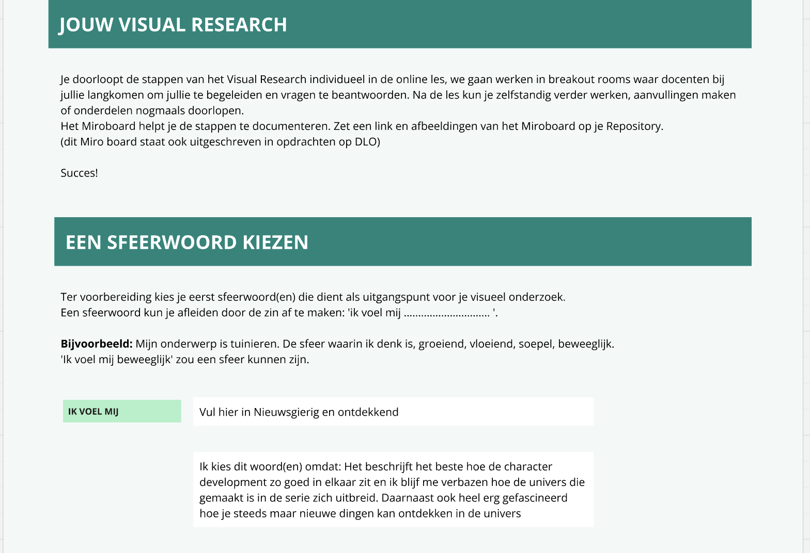.
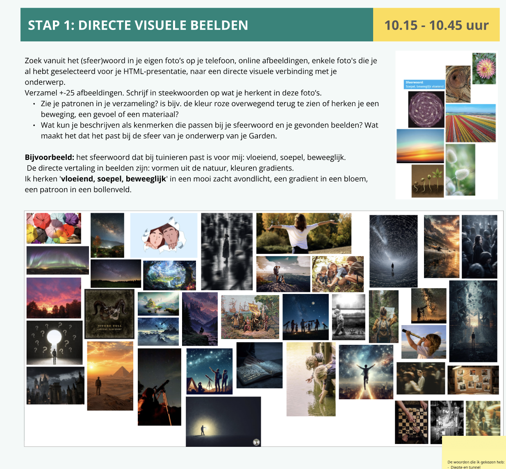.
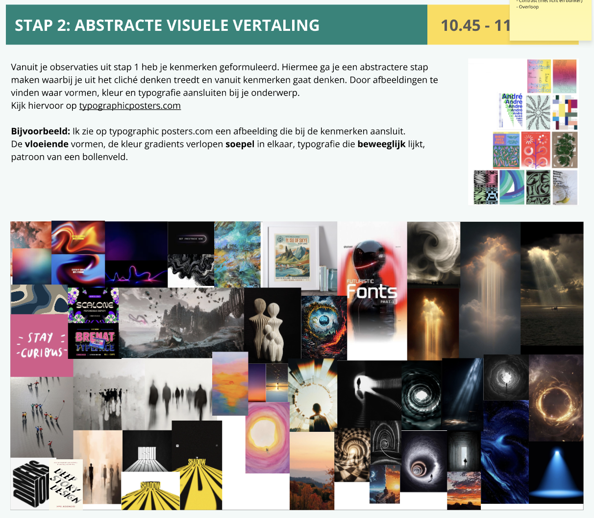.
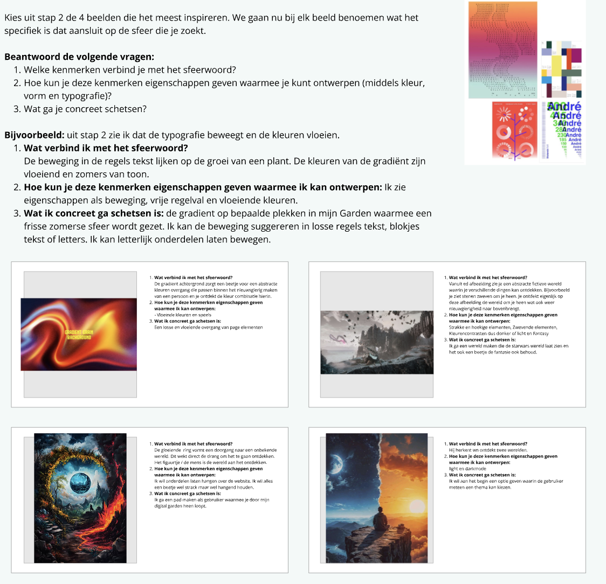.
.
.

# checkout 
Leg uit waar het Visual Research in 3 stappen naartoe werkt
Visual research werkt in 3 stappen:
- Direct beeld: Je zoekt direct plaatjes bij een sfeerwoord.
- Abstract maken: Je haalt de vormen, kleuren en lettertypes uit die beelden.
- Schetsen: Je gebruikt die abstracte elementen als vaste basis voor je eigen ontwerp.

Vertel in 2 zinnen waar jouw Garden over gaat, en met welke content je dat gaat doen (beeld, tekst, sound, animatie enz).
Ik ga mijn garden maken over de elementen van starwars die ik leuk vind. daarbij gebruik ik ene light en darkmodus die eigenlijk laat zijn hoe welke characters erbij passen en daar komt ook custom content terecht.

Vertel kort welk idee van de Crazy 8 je het liefst zou willen uitvoeren/ verder zou willen onderzoeken.
ik zou alle crazy eights willen uitvoeren. Dit is wel alleen afhankelijk of het haalbaar blijft.

### 7 september - les dag
Op maandag 7 september heb ik de volgende dingen gedaan
- Artikelen lezen over digital garden
- Begrijpen wat digital garden is.
- Het inschrijven op de deepdive naar intresse
- Rangschikken websites
- Onderwerp kiezen voor Digital Garden.

Om te bergijpen wat een digital garden is ben ik samen in een groepje van 4 andere mensen gaan kijken naar 5 verschillende artikelen. Hierin Heeft ieder 1 Artikel gelezen die gaan over Digital Garden. Vervolgens vertelde we de volgende bevindingen aan elkaar:
- Een digital garden is een plek waar je eigen fantasie en ontwerp tot leven komt.
- Je schrijft de content voor jezelf
- Je moet een beetje tegen kritiek kunnen.
- Een digital garden is nooit af.
- Hoe de Digital garden ontstaan is door de mexem manier waarbij een iemand een boek analyseert en alle ideeën bij elkaar komen en weer terug wordt geschreven in een boek. ZO kan een ander dat ook lezen.
- Een blog heeft een datum erbij staan en een digital garden niet.
- Je kan ideeën met elkaar vergelijken en samenbrengen waardoor er meer ideeën ontstaan.

Voor de eerste opdracht hebben we een werkvel gekregen waarmee je twee websites moest analyseren. Bij het analyseren kijk je dus of een websites  echt webby is. Dit hebben We gedaan doormiddel van een Werkblad met twee vragen.

In deze opdracht heb ik de twee websites  van mikemai.net geanalyseert en daarna de website Virtual Vampire Haven.
-  https://mikemai.net/
- https://virtualvampirehaven.neocities.org/Links

In het kort gaat de mikemai dat het echt een goeie website is op basis van de vragen. De website heeft een goeie hierarchie, layout, is responsive en heeft kleine interacties erin zitten.
De website is toegankelijk en heeft ook een een goeie leesbare tekst met korte kopjes en niet te lang. Door deze punten vind ik dat het een goeie website is.

De virtualVampireHaven is een website dat vooral met passie is gemaakt en is een verzameling van alle websites met vampieren. De website is neit responsive maar wel heel creatief.

Vervolgens zijn we in een groepje van 4 mensen samen onze bevinden gaan vertellen en kwamen we tot de conclusie dat de volgende website de meest webby was en welke het minst was. In de afbeelding hieronder zie je de uitkomsten van de analyse.
.

#### opdracht 2
- Vanuit de inventarisatie: Wat zou je zelf willen maken? Heb je dingen gezien die je nog niet kan, maar wel interessant vindt in de websites die je bekeken hebt?
Ik Heb nog geen gekozen onderwerp maar ik wil misschien de website gaan maken over de volgende onderwerpen:
    - Een website over fitness
    - Een starwars website
    - Een pokemon website
    - een webiste over haken
    - een website over eten

- Welke webby dingen heb je gezien die je ook wil gebruiken?
Voor de digital garden zou ik animaties, dark / lightmode willen maken, een duidleijke hierachie van de website waarin het onderwerp duide;lijk word en natuurlijk moet de website nog wel responsive worden.

- Welke eigen content zou je over het onderwerp kunnen schrijven? Wat is de toon, ​de context, het doel, wat zijn onderwerpen, wat is ‘het’ wat jou raakt!
De doel is weel om de teksten zo te schrijven dat dew gebruiker weet waar het over gaat. de teksten moeten goed leesbaar moeten worden en ook toegankelijk voor iedereen. 

- Maak je gebruik van content van een ander? Hoe denk je dat te doen? En mag dat eigenlijk wel? Hoe kan je die content zo aanpassen dat het echt een eigen verhaal wordt? Dat het echt jouw content wordt, op jouw eigen garden?
Als ik de content van een ander zou willen gebruiken dan vermeld ik wel debron waar ik het vandaan heb. daarnaast pas ik de content zo danig aan waardoor het wel mijn eigen creatie blijft.

- Op welke manier is de content te ervaren, denk verder dan alleen in tekst en beeld (beleeft, voelt, ziet, hoort enz.)
Ik zou afbeeldingen willen tekenen die te bewegen zijn op de website zelf. Ik zou daarnaast gebruik maken van verschillende kleurenpalleten die op elkaar aansluiten maar ook  nog bij het onderwerp past. daarnaast zou ik de afbeeldingen tot leven willen brengen aande hand van animaties

De uitwerking van de derde opdracht kan je terug vinden op het linkje hieronder.
[Visit Opdracht 3](./oefeningen/presentatie/index.html)

Leg uit wat een digital garden is en waarom dat anders is dan een reguliere website.
Een digital garden is een website die nooit af is en je hierin je vrije tijd de loop laat lijden.

Leg uit wat een website 'webby' maakt en welke websites jou het meeste inspireren.
Een website is pas webby als die een eigen duidelijk stijl hebt die ook inspirerend is en bij jezelf past. Daarnaast moet de website toegankelijkheid en de hierachie in een website.

Vertel waar jij mee aan de slag wilt gaan bij het maken van jouw eigen digital garden (let op: dit zijn jouw eerste ideeën, dit kan en mag veranderen in de loop van het programma.)
Ik ga hem als mijn eigen hobbie maken. Daarbij wil ik een eigen stijl creeren maar4 dat het nog wel bij de websites past. Hiermee moeten er animaties inzitten. Ook op de telefoon te bezoeken zijn.

### 3 sept - [Workshop]
Deze dag heb ik heel erg veel last van me knie gehad en ben hierbij thuis gebleven. 

### 2 september - [workshop dag 1]
Op woensdag heb ik eerst een workshop gevolgt van diederik met typography. Hierin besproken we hoe typography is ontstaan en krijgen we een kleine uitleg over de geschiedenis van typography. Diederiek had ons meegenomen naar hoe eerst de letters vaak handgeschreven zijn en hierbij moet je dan denken aan dat bijbels door monikken met de hand zijn geschreven en dat ze daar 1 jaar mee bezig waren. De monniken waren bezig met een bijbel 1 jaar lang. Dat is uiteindelijk door het drukwerk veel sneller gegaan. Hierdoor zijn er meerdere boeken gemaakt binnen een jaar tijd.

Zo heb je bijvoorbeeld 1 font Garamont die al bijvoorbeeld 450 jaar oud is en vandaag de dag nogsteeds wordt gebruikt.

### 31 aug - Kickoff

Een fork van de model repository gemaakt en gepubliceerd via mijn eigen Github omgeving.

## 📚 Bronnenlijst

### 1. Code, CSS-technieken & Interactie
* **CodePen – Lightsaber Glow, Rotatie & Rand-animaties:**
  * [Sixclones - Glowing Border / Animation](https://codepen.io/Sixclones/pen/MJrEgz) – Gebruikt voor de roterende lightsaber glow rand op de interactieve knoppen.
  * [creme - Lightsaber CSS](https://codepen.io/creme/pen/XXdZjM) – Inspiratie voor lightsaber hilts en laser-gloed.
  * [Aleix - Star Wars Elements](https://codepen.io/Aleix/pen/oWwoza) – Inspiratie voor thematische Star Wars webcomponenten.
  * [jh3y - CSS Interactions](https://codepen.io/jh3y/pen/gOmObQj) – Geavanceerde CSS interacties en pseudo-elementen.
* **CSS Shake Animatie:**
  * [Unused-CSS – CSS Shake Animation](https://unused-css.com/blog/css-shake-animation/) – Animatie voor tril- en feedback-effecten.
* **StackOverflow:**
  * [Local Storage Theme Switch](https://stackoverflow.com/questions/56871118/change-theme-and-store-it-in-local-storage) – Concept voor het persistent opslaan van de dark/light mode voorkeur via `localStorage`.
  * [Horizontal Rule Styling](http://stackoverflow.com/questions/14821087/what-is-the-right-way-to-create-a-horizontal-line-with-html-and-css) – Semantische scheidingslijnen stylen zonder overbodige `div`-elementen op `theme.html`.
* **MDN Web Docs (Toegankelijkheid & Web API's):**
  * [MDN - HTMLDialogElement.showModal()](https://developer.mozilla.org/en-US/docs/Web/API/HTMLDialogElement/showModal) – Voor het openen en beheren van de toegankelijke cookiepopup via het officiële `<dialog>` element.
  * [MDN - Window.localStorage](https://developer.mozilla.org/en-US/docs/Web/API/Window/localStorage) – Voor het veilig opslaan van gebruikersvoorkeuren in de browser.
  * [MDN - DOMContentLoaded](https://developer.mozilla.org/en-US/docs/Web/API/Document/DOMContentLoaded_event) – Voor het correct en vertragingsvrij laden van scripts.
* **AI-ondersteuning (Conform HvA-richtlijnen transparant vermeld):**
  * *Gemini / Claude:* Inezet als digitale gids en sparringpartner voor het berekenen van de `clamp()`-formules voor fluïde typografie (`algemenestyling.css`), W3C HTML/CSS-validatie en het foutloos opzetten van CSS Grid architecturen.

---

### 2. Afbeeldingen & Grafische Assets
* **Officiële Star Wars Databank ([StarWars.com Databank](https://www.starwars.com/databank)):**
  * *Jedi & Heroes:* Obi-Wan Kenobi, Anakin Skywalker, Yoda, Qui-Gon Jinn, Mace Windu, Plo Koon, Kit Fisto, Ki-Adi-Mundi, Saesee Tiin, Luke Skywalker, Leia Organa, Ahsoka Tano, Rey, Han Solo, Chewbacca, Padmé Amidala, Lando Calrissian, Poe Dameron, Finn, Jyn Erso, Cassian Andor, The Mandalorian, C-3PO, R2-D2, BB-8 en Grogu.
  * *Sith & Dark Side:* Darth Vader, Emperor Palpatine / Darth Sidious, Darth Maul, Count Dooku, Kylo Ren, Asajj Ventress, Supreme Leader Snoke, General Grievous, Darth Bane, Darth Plagueis, Moff Gideon, Grand Admiral Thrawn, Grand Moff Tarkin, Jango Fett, Boba Fett, Cad Bane, Bossk, IG-88, Captain Phasma, General Hux, Second Sister, Mother Talzin, Savage Opress, Shin Hati en Baylan Skoll.
* **Wallpapers & Hero Afbeeldingen:**
  * [Alpha Coders](https://wall.alphacoders.com/big.php?i=1247346) – Hero afbeelding van Obi-Wan Kenobi op de homepage.
  * [WallpaperCat](https://wallpapercat.com/darth-vader-wallpapers#download) – Hero afbeelding van Darth Vader op de darkside homepage.
  * [StarWars.com Jedi Council News](https://www.starwars.com/news/jedi-council) – Achtergrondafbeelding van de Hoge Jedi Raad op `karakterpagina.html`.
* **Pinterest Inspiratie & Schetsen:**
  * [Pinterest - Kyber Kristallen & Schetsen](https://nl.pinterest.com/pin/773282198505730945/) – Kyber kristallen en schetsen van Yoda & Huyang.
  * [Pinterest - Lightsaber Color Palette](https://es.pinterest.com/pin/51158145756833365/) – Kleur- en sfeerinspiratie voor de lightsaber-waardes in `colors.css`.

---

### 3. Obi-Wan Kenobi Film- & Serie Appearances
* [Wookieepedia – Episode I: The Phantom Menace](https://starwars.fandom.com/wiki/Star_Wars:_Episode_I_The_Phantom_Menace)
* [IMDb – Episode II: Attack of the Clones](https://www.imdb.com/title/tt0121765/)
* [IMDb – The Clone Wars](https://www.imdb.com/title/tt0458290/)
* [Pathé – Episode III: Revenge of the Sith](https://www.pathe.nl/nl/films/star-wars-episode-iii-revenge-of-the-sith-re-release-47269)
* [Wookieepedia – Obi-Wan Kenobi (Disney+ serie)](https://starwars.fandom.com/wiki/Obi-Wan_Kenobi)
* [TV Tropes – Star Wars Rebels](https://tvtropes.org/pmwiki/pmwiki.php/WesternAnimation/StarWarsRebels)
* [Amazon – Episode IV: A New Hope](https://www.amazon.nl/New-Hope-Star-Wars-Episode/dp/0345341465)
* [IMDb – Episode V: The Empire Strikes Back](https://www.imdb.com/title/tt0080684/)
* [IMDb – Episode VI: Return of the Jedi](https://www.imdb.com/title/tt0086190/)

---

### 4. Privacy & Wetgeving (AVG / GDPR)
* [GitHub Privacy Statement](https://docs.github.com/en/site-policy/privacy-policies/github-privacy-statement) – Gelinkt in de cookiepopup ter verantwoording van hosting via GitHub Pages.
* [TransIP Privacy Policy](https://www.transip.nl/legal/privacy-policy/) – Gelinkt in de cookiepopup ter verantwoording van de domeinnaamregistratie via TransIP.

